## Previously ...

- In Lecture 4 we made figures clear and honest, then prepared the table behind them in Tableau: a pivot, calculated fields, and two files merged into one data source.

## Going Forward

In general, through the lectures we have seen variables:

- Made of character strings (usually interpreted as categorical, but not always)
- Made of numbers (usually interpreted as continuous, but not always)

But variables can be made of many more values. In business analytics, **dates** and **locations** are particularly important: **how to handle date and location variables in Tableau?**

. . .

Tableau is particularly interesting because it creates interactive figures: **how to make them smart by customising their interactivity?**

. . .

Finally, the figures are assembled in a dashboard: **how to make them react together, and how to share the dashboard?**

# 1. Date and Location Types in Tableau

## Space and Time Variables {.smaller}

So far, we were only interested in two variable types:

- **Categorical** (made of characters), also called **Dimensions** in Tableau
- **Continuous** (made of numbers), also called **Measures** in Tableau

However, we have seen that sometimes...

- A categorical variable needs to be converted to continuous (e.g., an opinion scale)
- A continuous variable needs to be converted to categorical (e.g., `Survived`, coded 0/1, in the Titanic data)

> In Tableau, change the type of a variable by drag-and-drop between **Dimensions** and **Measures** in the Data pane

. . .

:::: {layout="[1,1]"}
::: {#first-column}

In addition to categorical and continuous variables, Tableau has special features to handle **Location** and **Date** type variables.

:::

::: {#second-column}

{fig-align="center" style="max-height:150px;"}

::: {style="font-size:0.5em;text-align:center;"}
Source: i2tutorials [](https://i2tutorials.com/wp-content/media/2023/03/d.png)
:::

:::
::::

## Date Type Variables

A date refers to a specific time: it can be any combination and format of year, month, day, hour, minute, second ...

For example, "March 23, 1984", "03/23/84", "23/03/1984" and "1984-03-23" have **different formats but refer to the same date**.

In data science, we use the ISO 8601 international standard format (YYYY-MM-DD), "1984-03-23", which sorts dates easily.

By default, a date variable should be properly encoded: a **calendar icon** appears before it. If it is encoded as categorical (Abc) or continuous (#), convert it to **Date** or **Date & Time**. In `insta-data.csv`, `posted_at` (`2025-01-08 20:00:00`) is a Date & Time.

## Line and Area Charts

Date variables are usually used as the **X axis** (**Columns** in Tableau) to display the evolution of another variable over time.

The resolution of the chart can be adjusted by clicking on the **+** symbol of the date variable: from the year to the quarter, the month, the day ...

{fig-align="center" style="max-height:330px;"}

::: {style="font-size:0.5em;text-align:center;"}
Source: Tableau Help [](https://help.tableau.com/current/pro/desktop/en-us/Img/datefunctions3.png)
:::

## Line and Area Charts {.smaller}

While the date variable is in one field, drag and drop the other variable in the other field. It uses a **statistical aggregation**: by default the sum (SUM), but it can be changed to count, median, average ...

To add a **second line in the same figure**:

1. Drag and drop the second variable in **Rows**, next to the first one
2. Open the menu of its pill ( right-click /  <kbd>⌃ Control</kbd> + click) and select **Dual Axis** to merge them
3. If both variables have the same unit (e.g., euros), open the menu of the right axis and select **Synchronise Axis**

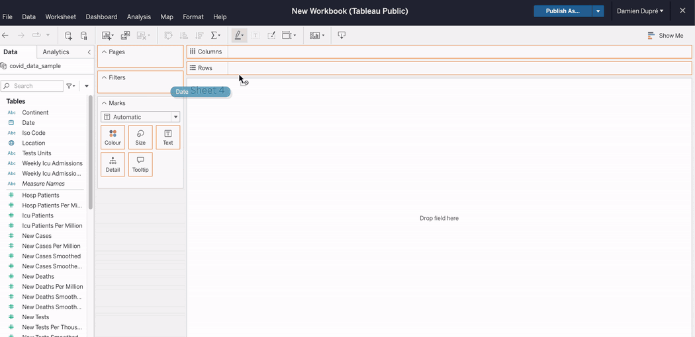{fig-align="center" style="max-height:300px;"}

::: {style="font-size:0.7em;text-align:center;"}
The recordings in this lecture use a Covid-19 sample: the clicks are the same with your own data.
:::

## Time as a Dimension or as a Measure {.smaller}

A date can be used as a **Dimension** (discrete, blue pill) or as a **Measure** (continuous, green pill). Switch from one to the other in the menu of the date pill: **Discrete** or **Continuous**.

:::: {layout="[1,1]"}
::: {#first-column}

**As a Dimension**: each unit of time (year, quarter, month ...) is a category with its own header. The line stops at the end of each year: **gaps between the units**.

{fig-align="center" style="max-height:290px;"}

:::

::: {#second-column}

**As a Measure**: time is a continuous axis, a timeline. The line runs from the first date to the last: **no gaps between the units**.

{fig-align="center" style="max-height:290px;"}

:::
::::

A Dimension compares the same units year by year; a Measure follows the trend over the whole period.

::: {style="font-size:0.5em;text-align:center;"}
Source: Change Date Levels, Tableau Help [](https://help.tableau.com/current/pro/desktop/en-us/dates_levels.htm)
:::

## Line and Area Charts

More details about Tableau and time series figures, among other resources found online:

:::: {layout="[1.3,1]"}
::: {#first-column}

- [Building Line Charts](https://help.tableau.com/current/pro/desktop/en-us/buildexamples_line.htm) by Tableau
- [Change Date Levels](https://help.tableau.com/current/pro/desktop/en-us/dates_levels.htm) by Tableau
- [Date Functions](https://help.tableau.com/current/pro/desktop/en-us/functions_functions_date.htm) by Tableau
- [Tableau Playbook: Line Chart](https://www.pluralsight.com/guides/tableau-playbook-line-chart) by Pluralsight

:::

::: {#second-column}

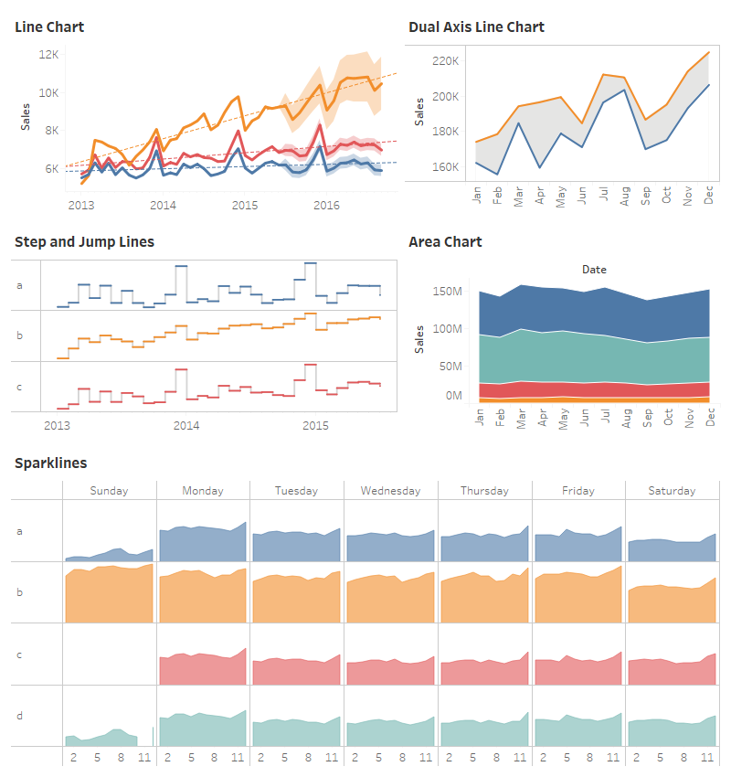{fig-align="center" style="max-height:430px;"}

:::
::::

## Live Example: Loomrow Over Time {.center .concept}

##  Your Turn! {background="#43464B"}

### Loomrow over time

With `insta-data.csv`:

1. Check that `posted_at` has a calendar icon
2. `reach` by month: which month peaks? Which Lecture 3 post explains it?
3. `spend_eur` and `attributed_revenue_eur` by month on a synchronised dual axis: how much revenue per euro spent?

::: {#timer5_1 .timer seconds="300" starton="interaction"}
:::

## Location Type Variables {.smaller}

A list of geographical locations by:

- Continents (Europe, Asia, Africa, Oceania, North America, South America)
- Countries (Ireland, France, Spain, Germany ...)
- States, regions, counties, cities ...

By default, a location variable should be properly encoded: a **globe icon** appears before it. If it is encoded as categorical (made of characters) or continuous (made of numbers), give it a **Geographic Role**.

{fig-align="center" style="max-height:250px;"}

::: {style="font-size:0.5em;text-align:center;"}
Source: Get Started Mapping with Tableau, Tableau Help [](https://help.tableau.com/current/pro/desktop/en-us/buildexamples_maps.htm)
:::

## Mapping with Tableau {.smaller}

To create a map:

1. Drag and drop the **location variable in Rows or Columns** of the worksheet
2. Use **Show Me** and select one of the map figures (the Longitude and Latitude variables are generated automatically):
    - **Symbol map**: the data are reduced to a point (good for cities)
    - **Map**: the data fill the full shape of the location
3. Drag and drop another variable in the **Colour** box of the Marks card, to display how its values change by location

{fig-align="center" style="max-height:260px;"}

::: {style="font-size:0.5em;text-align:center;"}
Source: datadent.org [](https://i0.wp.com/datadent.org/wp-content/uploads/2020/03/Map-change-colors.gif)
:::

## Mapping with Tableau {.smaller}

More details about Tableau and maps, among other resources found online:

- [Get Started Mapping with Tableau](https://help.tableau.com/current/pro/desktop/en-us/buildexamples_maps.htm) by Tableau
- [Build a Simple Map](https://help.tableau.com/current/pro/desktop/en-us/maps_howto_simple.htm) by Tableau
- [Tableau Maps: How to Create Stunning Maps in Tableau](https://www.youtube.com/watch?v=MT-HlqUHLFU) by Vizual Intelligence (video)
- [Create a Map in Tableau](https://www.tutorialgateway.org/maps-in-tableau/) by Tutorial Gateway
- [Create a Map with Multiple Layers in Tableau](https://www.youtube.com/watch?v=bwUj2NZHTC4) by Anthony Smoak (video)

:::: {layout="[1,1]"}
::: {#first-column}

{fig-align="center" style="max-height:200px;"}

:::

::: {#second-column}

{fig-align="center" style="max-height:200px;"}

:::
::::

::: {style="font-size:0.7em;text-align:center;"}
A symbol map (left) and a filled map (right)
:::

## A Second File, With Countries {.smaller}

`insta-data.csv` has no location, but Meta Ads Manager breaks the results of the 127 paid posts down by country: `ads-by-country.csv`, one row per post and country.

| post_id | country | amount_spent_eur | purchases | purchase_value_eur |
|---|---|---|---|---|
| LR0040 | Ireland | 202.33 | 8 | 877.84 |
| LR0040 | United Kingdom | 59.64 | 1 | 104.24 |
| LR0042 | Ireland | 93.82 | 5 | 507.76 |
| LR0042 | United Kingdom | 44.71 | 1 | 96.47 |

- Merge it with a **relationship** on `post_id`, as in Lecture 4: each table keeps its own rows
- Check the totals: `SUM(amount_spent_eur)` is €24,345.78, the `spend_eur` of `insta-data.csv`
- With a **join**, each paid post appears once per country: `SUM(spend_eur)` jumps to €106,899.36

## Live Example: Mapping Loomrow's Ads {.center .concept}

##  Your Turn! {background="#43464B"}

### Map Loomrow's ads

From Loop, download `ads-by-country.csv`, then with `insta-data.csv`:

1. Relate the two files on `post_id`, and check the totals
2. `country` should have a globe icon: a symbol map of `purchases`. Where do the sales come from?
3. A filled map of the return on ad spend, `SUM([Purchase Value Eur]) / SUM([Amount Spent Eur])`: where does a euro go furthest?
4. Belgium and Italy: how many purchases behind them?

::: {#timer5_2 .timer seconds="420" starton="interaction"}
:::

# 2. Interactive Customisations in Tableau

## Where We Stopped

Last week, in Tableau:

- **Dates**: a Dimension (blue pill, gaps between the units) or a Measure (green pill, one timeline), and two measures on a **Dual Axis**
- **Locations**: a **Geographic Role**, then a symbol map or a filled map
- **A second file**: `ads-by-country.csv`, related to `insta-data.csv` on `post_id`

**Today**:

1. Make the figures smart with interactive customisations
2. Assemble the figures in a dashboard, with actions
3. The brief of Assignment 1

## Aliases and Groups {.center .concept}

## Variable Alias {.smaller}

Not an interactive feature, but a simple and useful tip: an **alias** renames the categories displayed by a variable, while the calculations keep the original values.

**How**: in the Data pane, open the menu of the variable ( right-click /  <kbd>⌃ Control</kbd> + click) → **Aliases...**, then type the new names.

::: {style="font-size:0.8em;text-align:center;"}
**Without aliases**: `Survived` (Titanic data) shows its codes, 0 and 1
:::

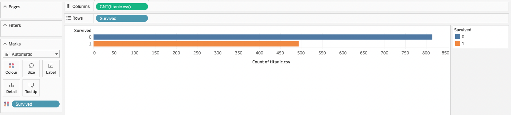{fig-align="center" style="max-height:135px;"}

::: {style="font-size:0.8em;text-align:center;"}
**With aliases**: 0 is displayed as Did not survive, 1 as Survived
:::

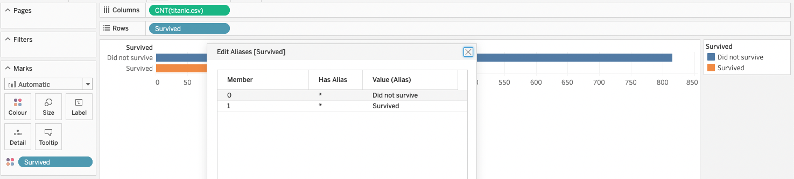{fig-align="center" style="max-height:135px;"}

## Groups {.smaller}

An alias renames one category; a **group** merges several categories into one: to correct spellings, or to compare families of categories.

:::: {layout="[1.2,1]"}
::: {#first-column}

**How**: in the Data pane, open the menu of the variable ( right-click /  <kbd>⌃ Control</kbd> + click) → **Create** → **Group...**, then:

1. Select the categories to merge and click **Group**
2. Rename the group
3. Tick **Include 'Other'** to merge all the remaining categories

**Shortcut**: select marks in the figure, then click the paperclip icon of their tooltip.

:::

::: {#second-column}

{fig-align="center" style="max-height:110px;"}

{fig-align="center" style="max-height:180px;"}

:::
::::

**Loomrow**: `campaign` mixes three launches (SS25_Launch, AW25_Preorder, SS26_Launch) and three sales (Summer_Sale_25, Black_Friday_25, Deadstock_Drop_26), two groups to compare.

::: {style="font-size:0.5em;text-align:center;"}
Source: Group Your Data, Tableau Help [](https://help.tableau.com/current/pro/desktop/en-us/sortgroup_groups_creating.htm)
:::

##  Your Turn! {background="#43464B"}

### Rename and group

With `insta-data.csv`:

1. Alias `is_paid`: **False** as Organic, **True** as Paid
2. Group the campaigns into **Launches** and **Sales**
3. `SUM([Attributed Revenue Eur]) / SUM([Spend Eur])` by campaign group: which group returns more per euro spent?

::: {#timer5_3 .timer seconds="300" starton="interaction"}
:::

## Marks, Labels and Tooltips {.center .concept}

## Marks Card {.smaller}

Tableau designs the default figure automatically, according to what it considers the most relevant. The **Marks card** changes this design:

:::: {layout="[1.7,1]"}
::: {#first-column}

1. **The type of mark**: the drop-down at the top (Automatic, Bar, Line, Circle ...)
2. **The design of the marks**: Colour, Size, Label, Detail and Tooltip

Each property of the design can be set:

- **For all the marks**: click it, e.g., one colour for all the bars
- **By the values of a variable**, already used or additional: drag the variable onto it, e.g., `format` on **Colour** gives one colour per format, `reach` on **Size** bigger marks for a bigger reach

:::

::: {#second-column}

{fig-align="center" style="max-height:340px;"}

::: {style="font-size:0.5em;text-align:center;"}
Source: Shelves and Cards Reference, Tableau Help [](https://help.tableau.com/current/pro/desktop/en-us/buildmanual_shelves.htm)
:::

:::
::::

## Labels and Annotations {.smaller}

:::: {layout="[1,1.25]"}
::: {#first-column}

**Labels** write the values on the marks. Click **Label** in the Marks card, then choose the marks to label: all of them, the minimum and maximum, the line ends, or only the selected or highlighted ones.

**Annotations** point at an insight. Open the menu of a mark ( right-click /  <kbd>⌃ Control</kbd> + click) → **Annotate**, then choose:

- **Mark**: attached to a mark, it follows it when the view changes
- **Point**: attached to a position in the figure
- **Area**: a box around a group of marks

:::

::: {#second-column}

{fig-align="center" style="max-height:340px;"}

:::
::::

::: {style="font-size:0.5em;text-align:center;"}
Source: Add Annotations, Tableau Help [](https://help.tableau.com/current/pro/desktop/en-us/annotations_annotations_add.htm)
:::

## Tooltip Principle

The **tooltip** is a series of information (numeric or graphic) displayed in a temporary box when the cursor goes over, or clicks on, an element of a figure. It gives the actual numbers behind the figure, and tells a short story about what is currently seen.

:::: {layout="[1,1,1]"}
::: {#first-column}

{fig-align="center" style="max-height:150px;height:150px;object-fit:contain;"}

::: {style="font-size:0.7em;text-align:center;"}
The default tooltip
:::

:::

::: {#second-column}

{fig-align="center" style="max-height:150px;height:150px;object-fit:contain;"}

::: {style="font-size:0.7em;text-align:center;"}
A tooltip with conditional formatting
:::

:::

::: {#third-column}

{fig-align="center" style="max-height:150px;height:150px;object-fit:contain;"}

::: {style="font-size:0.7em;text-align:center;"}
A figure in the tooltip
:::

:::
::::

::: {style="font-size:0.5em;text-align:center;"}
Sources: InterWorks [](https://interworks.com/wp-content/uploads/sites/default/files/wp-content/uploads/2010/08/TTDefault.png) [](https://interworks.com/blog/interworks/2010/09/03/tableau-tooltips-conditional-formatting/) and Tableau [](https://cdns.tblsft.com/sites/default/files/blog/vit-gif-for-blog_leave-for-work.gif)
:::

## Tooltip Editing

By default, the tooltip lists the variables of the figure, one per line. Click **Tooltip** in the Marks card to edit it: the text is free, and each **variable between `< >`** shows its value under the cursor (in annotations too).

:::: {layout="[1.2,1]"}
::: {#first-column}

For example, on `reach` by month:

::: {style="font-size:1.1em;"}
```
Month of Posted At:  <MONTH(Posted At)>
Reach:               <SUM(Reach)>
```
:::

:::

::: {#second-column}

Will show:

::: {style="font-size:1.1em;"}
```
Month of Posted At:  August 2025
Reach:               685,460
```
:::

:::
::::

Rewritten as a sentence, the same tooltip tells a story:

::: {style="font-size:1.1em;"}
```
In <MONTH(Posted At)>, <CNTD(Post Id)> posts reached <SUM(Reach)> accounts!
```
:::

Will show:

::: {style="font-size:1.1em;"}
```
In August 2025, 26 posts reached 685,460 accounts!
```
:::

## Tooltip Advanced {.smaller}

Two ways to put more in a tooltip:

- **Another variable**: drag it onto **Tooltip** in the Marks card, e.g., `post_id`, counted with **Count (Distinct)**
- **A full figure**: when editing the tooltip, click **Insert** → **Sheets** → the name of the figure to add (*Viz in Tooltip* in Tableau Help)

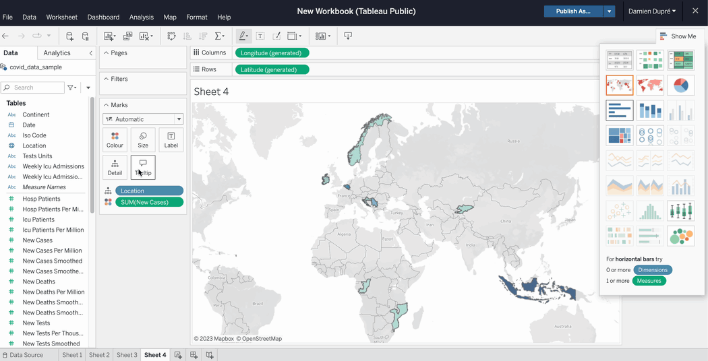{fig-align="center" style="max-height:380px;"}

##  Your Turn! {background="#43464B"}

### Labels and tooltips

On your sheet of `reach` by month:

1. Label the highest month, and annotate it with the post that explains it
2. Rewrite the tooltip as a sentence, with the number of posts
3. Insert a sheet in the tooltip: `reach` by `format` for the month under the cursor

::: {#timer5_5 .timer seconds="360" starton="interaction"}
:::

## Filters and Highlighters {.center .concept}

## Local Filters

A **filter** displays only specific data. Drag a variable onto the **Filters** shelf, then select what to keep: categories for a categorical variable, values for a continuous one.

{fig-align="center" style="max-height:320px;"}

::: {style="font-size:0.5em;text-align:center;"}
Source: Filter Data from Your Views, Tableau Help [](https://help.tableau.com/current/pro/desktop/en-us/filtering.htm)
:::

## Types of Filters {.smaller}

:::: {layout="[1.35,1]"}
::: {#first-column}

The filter dialog depends on the variable:

- A **Dimension** (categories) has four tabs:
    - **General**: tick the categories to keep
    - **Wildcard**: the names that contain, start or end with a text
    - **Condition**: the categories whose measure meets a rule, e.g., a `SUM([Reach])` of at least 10,000
    - **Top**: the top or bottom *N*, e.g., the 10 posts with the highest `SUM([Reach])`
- A **Measure** keeps a range of values: at least, at most, or between two values
- A **Date** keeps a range of dates, **relative dates** (e.g., the last 3 months), or date parts (e.g., the years 2025 and 2026)

:::

::: {#second-column}

{fig-align="center" style="max-height:360px;"}

:::
::::

::: {style="font-size:0.5em;text-align:center;"}
Source: Filter Data from Your Views, Tableau Help [](https://help.tableau.com/current/pro/desktop/en-us/filtering.htm)
:::

## Local Filter Menu {.smaller}

A **filter menu** (a *filter card* in Tableau Help) lets the readers make their own selection.

:::: {layout="[1.5,1]"}
::: {#first-column}

**Add it**:

1. Click **Analysis** in the top toolbar → **Filters** → the variable the readers choose from
2. Customise the menu from its drop-down arrow

[]{style="color:#2a78d6;"} Note: the same result comes from the **Filters** shelf: open the menu of the variable → **Show Filter**.

**Choose its style**:

- **Single value**: a list, a drop-down or a slider
- **Multiple values**: a list or a drop-down
- **Range**: a slider, for measures and dates

Tick **Only Relevant Values** to hide the values that the other filters exclude.

:::

::: {#second-column}

{fig-align="center" style="max-height:400px;"}

:::
::::

::: {style="font-size:0.5em;text-align:center;"}
Source: Filter Data from Your Views, Tableau Help [](https://help.tableau.com/current/pro/desktop/en-us/filtering.htm)
:::

## One Filter, Several Sheets {.smaller}

By default, a filter only changes its own sheet. On a dashboard, the readers expect one filter menu to change all the figures.

:::: {layout="[1.1,1]"}
::: {#first-column}

On the **Filters** shelf, open the menu of the variable → **Apply to Worksheets**:

- **All Using Related Data Sources**: every sheet using `insta-data.csv` or `ads-by-country.csv`, related on `post_id`
- **All Using This Data Source**: every sheet using the same data source
- **Selected Worksheets...**: the sheets you tick
- **Only This Worksheet**: the default

A filter shared by several sheets gets an icon on the Filters shelf.

:::

::: {#second-column}

{fig-align="center" style="max-height:320px;"}

:::
::::

::: {style="font-size:0.5em;text-align:center;"}
Source: Apply Filters to Multiple Worksheets, Tableau Help [](https://help.tableau.com/current/pro/desktop/en-us/filtering_global.htm)
:::

## Local Highlighter Menu {.smaller}

A **highlighter menu** lets the readers focus the figures on some categories. Unlike a filter, it keeps all the data in the figure: the categories not selected are only dimmed.

:::: {layout="[1,1.2]"}
::: {#first-column}

**Add it**:

1. Click **Analysis** in the top toolbar → **Highlighters** → the variable the readers highlight from
2. Customise the menu from its drop-down arrow (fewer options than a filter menu)

On a dashboard, the highlighter menu applies to all the figures that use the highlighted variable.

:::

::: {#second-column}

{fig-align="center" style="max-height:300px;"}

:::
::::

::: {style="font-size:0.5em;text-align:center;"}
Source: Quickly Find Marks in Context with Tableau 10's New Highlighter, Tableau [](https://www.tableau.com/blog/check-out-new-highlighter-tableau-10-54969)
:::

##  Your Turn! {background="#43464B"}

### Filter and highlight

1. A filter menu on `format` (multiple values, drop-down) on your monthly sheet, applied to all the sheets using `insta-data.csv`
2. A bar chart of the 10 posts with the highest `reach` (a Top filter on `post_id`): which formats and themes?
3. `reach` by `theme`: a filter on `theme`, then a highlighter. Select customer in each: where does it rank?

::: {#timer5_6 .timer seconds="420" starton="interaction"}
:::

## Time Animation Player {.center .concept}

## Time Animation Player

Drag a date variable onto the **Pages** shelf to play the figure over time:

1. A player appears: play forwards or backwards, page by page, at the speed you choose
2. Tick **Show History** to keep the marks of the previous pages as trails

{fig-align="center" style="max-height:260px;"}

::: {style="font-size:0.5em;text-align:center;"}
Source: Medium [](https://miro.medium.com/max/1400/1*9wAYT7RHcaZOCNs0suDcmg.gif)
:::

# 3. Tableau Dashboard

## What Is a Dashboard?

:::: {layout="[1,1]"}
::: {#first-column}

For Stephen Few, a dashboard is a visual display of the few things that matter to reach an objective, arranged on **one screen** and readable **at a glance**.

Like the dashboard of a car: the few numbers needed to drive, readable in a second, with warning lights when something goes wrong.

::: {style="font-size:0.7em;"}
Few, S. (2006). *Information Dashboard Design: The Effective Visual Communication of Data*. O'Reilly.
:::

:::

::: {#second-column}

{fig-align="center" style="max-height:380px;"}

:::
::::

## Tableau Dashboard Showcase

Federica Pinza's visualisation, DCU winner of the 2024 European Data Visualisation Challenge organised by EDHEC

{fig-align="center" style="max-height:430px;"}

## Tableau Dashboard Showcase

:::: {layout="[1,1.6]"}
::: {#first-column}

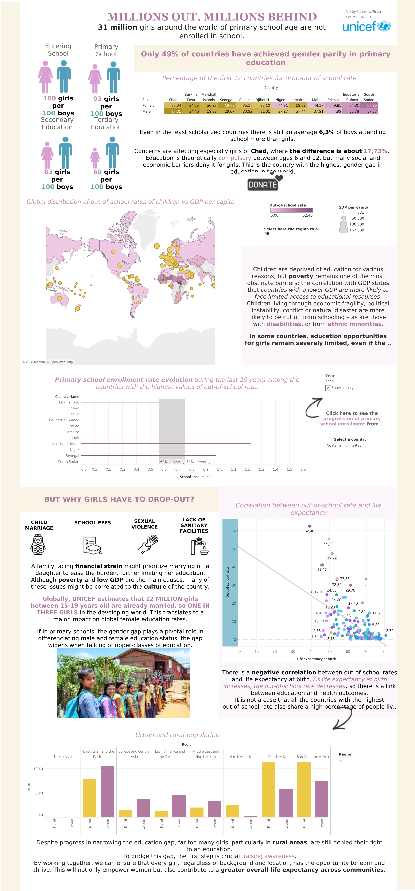{fig-align="center"}

:::

::: {#second-column}

[ Link to the dashboard](https://public.tableau.com/app/profile/federica.pinza/viz/Aglobalfightforgenderequalityineducation/Dashboard1)

One long page, read from top to bottom:

- a headline and the key numbers
- a map, a trend and a correlation
- the causes, explained with icons and text
- a conclusion with a call to action

:::
::::

## Nice Interactions and Design

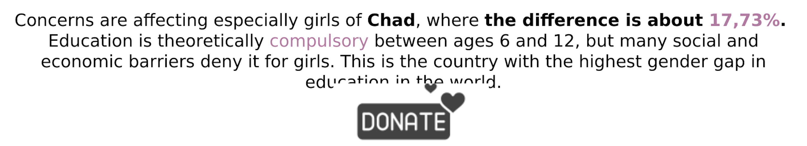{fig-align="center"}

::: {style="font-size:0.7em;text-align:center;"}
Key numbers in colour inside the text, and a **Donate** button
:::

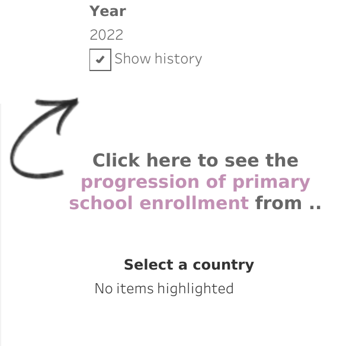{fig-align="center" style="max-height:200px;"}

::: {style="font-size:0.7em;text-align:center;"}
A year player with **Show history**, and a highlighter to select a country
:::

## Meaningful Visualisations

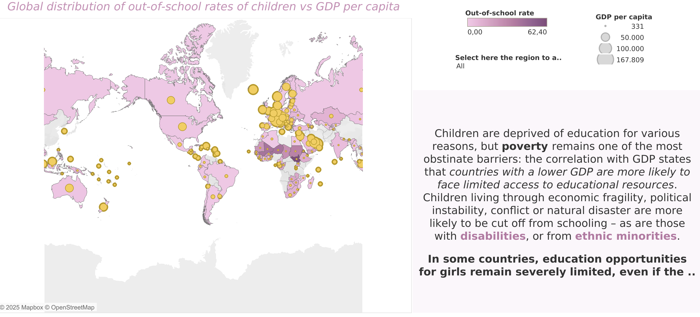{fig-align="center" style="max-height:230px;"}

::: {style="font-size:0.7em;text-align:center;"}
Two measures on one map, the out-of-school rate (colour) and GDP per capita (circles), with a text to read it
:::

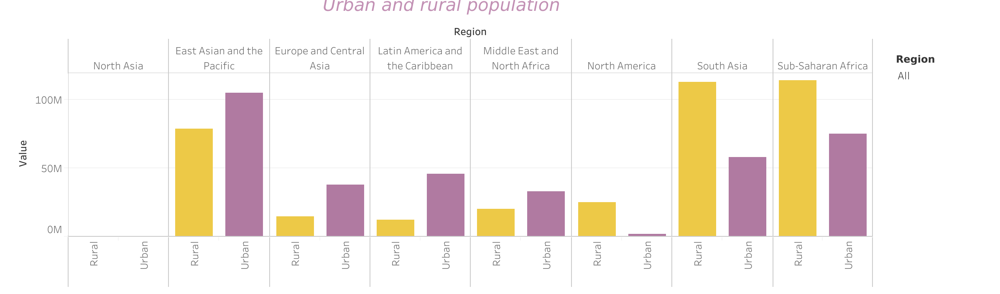{fig-align="center" style="max-height:170px;"}

::: {style="font-size:0.7em;text-align:center;"}
Rural against urban population by region, in the two colours of the dashboard
:::

## Insightful Storytelling

{fig-align="center" style="max-height:280px;"}

::: {style="font-size:0.7em;text-align:center;"}
The causes: one icon each, short texts, and the key numbers in bold and colour
:::

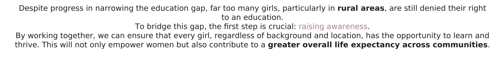{fig-align="center"}

::: {style="font-size:0.7em;text-align:center;"}
The conclusion: a summary, and a call to action, raising awareness
:::

## Example Not to Follow! {.smaller}

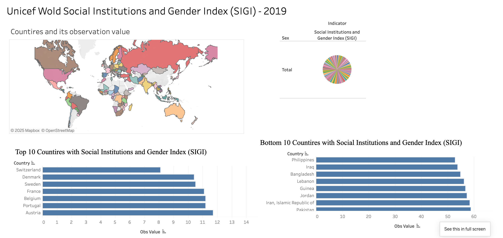{fig-align="center" style="max-height:300px;"}

- **Titles**: typos, "Wold" and "Countires"
- **Colours**: one colour per country on the map, and a pie with one slice per country: the colours carry no information
- **Axes and fonts**: raw field names as axis titles ("Obs Value"), two bar charts on different scales, and two different fonts
- **Story**: no text to say what the index measures, or what to conclude

## Before Building: Purpose and Audience {.smaller}

Tableau's best practices for dashboard design:

:::: {layout="[1,1,1,1,1]"}
::: {#first-column}

{fig-align="center" style="max-height:80px;"}

::: {style="font-size:0.8em;text-align:center;line-height:1.2;"}
Know your audience
:::

:::

::: {#second-column}

{fig-align="center" style="max-height:80px;"}

::: {style="font-size:0.8em;text-align:center;line-height:1.2;"}
Consider display size
:::

:::

::: {#third-column}

{fig-align="center" style="max-height:80px;"}

::: {style="font-size:0.8em;text-align:center;line-height:1.2;"}
Plan for fast load times
:::

:::

::: {#fourth-column}

{fig-align="center" style="max-height:80px;"}

::: {style="font-size:0.8em;text-align:center;line-height:1.2;"}
Leverage the sweet spot
:::

:::

::: {#fifth-column}

{fig-align="center" style="max-height:80px;"}

::: {style="font-size:0.8em;text-align:center;line-height:1.2;"}
Limit views and colours
:::

:::
::::

The first one comes before the first sheet. Answer four questions:

- **Who** will read it, and what do they already know?
- **What question** does it answer, and **what decision** will it support?
- **Where** will it be read: on a laptop, a phone, a projector?
- **Explore or explain?** An exploratory dashboard lets readers search the data; an explanatory one tells them one story. Your assignment is explanatory: it ends with a recommendation.

**The 5-second test**: after looking at it for 5 seconds, a reader should be able to say what it is about.

::: {style="font-size:0.5em;text-align:center;"}
Source: Dashboard Design Best Practices, Tableau [](https://www.tableau.com/learn/articles/dashboard-design-best-practices)
:::

## Design Strategy

Creating a perfect Tableau dashboard is easy if you follow these steps:

1. **Basic figures**: create many figures that can support your story, and keep their default settings
2. **Basic dashboard**: put the most relevant figures in a dashboard, with its title, text and pictures, but no design work yet
3. **Figure improvement**: go back to the worksheet of each figure and customise it: colour, size, shapes, title, captions, axes and interactions
4. **Dashboard improvement**: go back to the dashboard and customise it: background, colours, fonts, layout and actions

## Overall Design Guidelines

Keep them in mind at every step:

:::: {layout="[1,1]"}
::: {#first-column}

1. Don't overwhelm viewers
2. Avoid visual clutter
3. Avoid poor visual design
4. Don't add too much data
5. Provide for consistency
6. Provide for interaction affordances
7. Manage complexity

:::

::: {#second-column}

8. Organise charts
9. Increase information
10. Avoid redundancy of information
11. Design is an iterative process
12. Context is very important
13. Use colour carefully

:::
::::

## Dashboard Types

Dashboards come in genres: **curated** ones tell one story (e.g., magazine, infographic), **data collections** let the readers explore (e.g., analytical, repository). Your assignment is a curated dashboard.

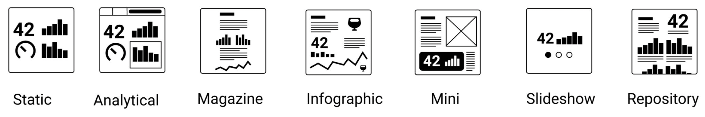{fig-align="center"}

::: {style="font-size:0.5em;text-align:center;"}
Source: Dashboard Design Patterns [](https://dashboarddesignpatterns.github.io/)
:::

- [See the Dashboard Design Patterns workshop for more details](https://dashboarddesignpatterns.github.io/workshop.html)

## Key Elements

:::: {layout="[1,1]"}
::: {#first-column}

Every dashboard should include these key elements to fill its screenspace:

- A title
- A written story, with an introduction, an analysis and a conclusion
- Multiple visualisations

Optional elements can be added, such as images, buttons or menus.

:::

::: {#second-column}

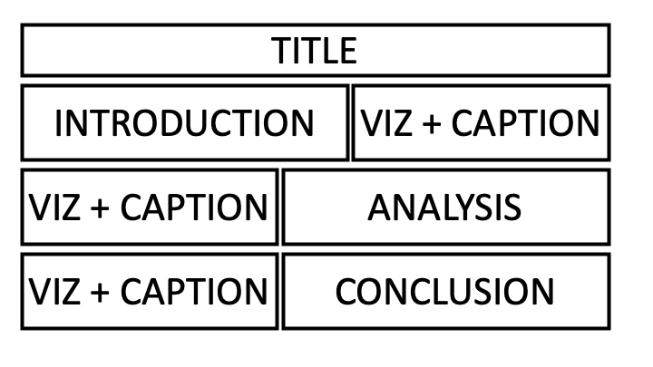{fig-align="center"}

::: {style="font-size:0.5em;text-align:center;"}
Example of a dashboard structure, for illustration only: not necessarily to follow.
:::

:::
::::

## Key Elements: Title

:::: {layout="[1,1]"}
::: {#first-column}

A good title, as in these [real dashboards](https://www.tableau.com/blog/tableau-public-viz-wrap-interesting-data-visualizations-2022):

- **Pinpoints the problem**: ["Healthcare Crisis in Rural America"](https://public.tableau.com/app/profile/dennis.kao/viz/HealthcareCrisisinRuralAmericaProjectHealthViz/Dashboard1)
- **Makes a statement or asks a question**: ["#CollegeGameday: Can My Family Out-Pick the Pundits?"](https://public.tableau.com/app/profile/sam.epley/viz/CollegeGamedayCanMyFamilyOut-PickthePundits/PickbyWeek)
- **Is catchy**: ["NBA Lords of the Rings"](https://public.tableau.com/app/profile/jeff.plattner4532/viz/NBALordsoftheRings/LordsoftheRings)

:::

::: {#second-column}

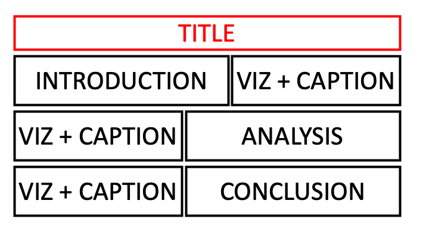{fig-align="center"}

:::
::::

## Key Elements: Story

:::: {layout="[2,1]"}
::: {#first-column}

The story, the narrative conveying the information, has three parts:

- **Introduction**: presents the context of the issue investigated
- **Analysis**: extracts the relevant information from each visualisation, each piece linked to the others (temporal, geographical, logical ...)
- **Conclusion**: summarises the information and provides recommendations to the reader

:::

::: {#second-column}

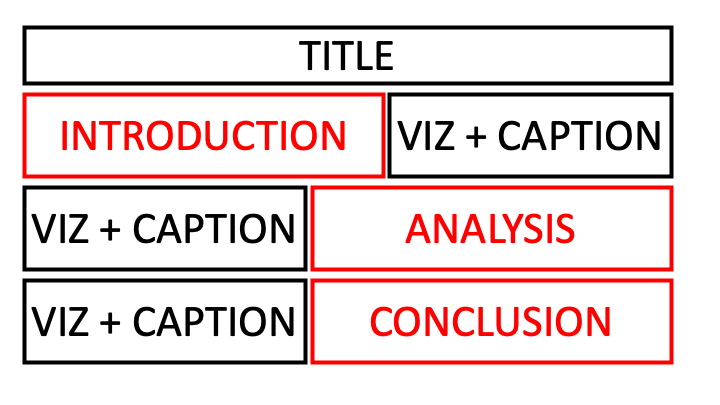{fig-align="center"}

:::
::::

## Key Elements: Visualisations

:::: {layout="[1,1]"}
::: {#first-column}

1. Place your visualisations in a relevant order
2. Make sure they are customised
3. Add a caption
4. Add global interactive features

:::

::: {#second-column}

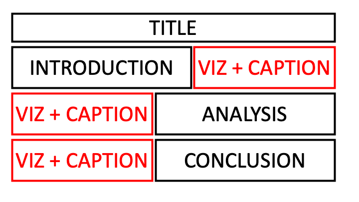{fig-align="center"}

:::
::::

## Big Numbers First

Marketing dashboards often open with a few **KPIs** (Key Performance Indicators) as big numbers: at the top left, each with a comparison. For Loomrow, January to June 2026 against January to June 2025:

:::: {layout="[1,1,1]"}
::: {#first-column}

::: {style="text-align:center;"}
[2.06M]{style="font-size:2.2em;font-weight:700;color:#23373b;"}

accounts reached

[ against 0.45M]{style="color:#3a9a5b;font-weight:500;font-size:0.9em;"}
:::

:::

::: {#second-column}

::: {style="text-align:center;"}
[6.3%]{style="font-size:2.2em;font-weight:700;color:#23373b;"}

engagement rate

[ against 6.4%]{style="color:#e34948;font-weight:500;font-size:0.9em;"}
:::

:::

::: {#third-column}

::: {style="text-align:center;"}
[€2.75]{style="font-size:2.2em;font-weight:700;color:#23373b;"}

of revenue per €1 spent

[ against €3.46]{style="color:#e34948;font-weight:500;font-size:0.9em;"}
:::

:::
::::

In Tableau: one sheet per number, with the measure on **Text** in the Marks card, then the sheets side by side in a horizontal container. The engagement rate:

```
(SUM([Engagements Followers]) + SUM([Engagements Non Followers])) / SUM([Reach])
```

## Layout: the Sweet Spot {.smaller}

:::: {layout="[1,1.1]"}
::: {#first-column}

Readers scan a screen from the **top left**, then across and down: put the most important view (or the KPIs) in that corner, and the details below or to the right.

- Few views: Tableau suggests two or three main ones
- Align the views on a grid, with white space between the groups
- Place each legend and filter next to the view it controls
- Keep the same colour for the same category on every sheet

:::

::: {#second-column}

{fig-align="center" style="max-height:360px;"}

:::
::::

::: {style="font-size:0.5em;text-align:center;"}
Source: Best Practices for Effective Dashboards, Tableau Help [](https://help.tableau.com/current/pro/desktop/en-us/dashboards_best_practices.htm)
:::

## Tableau Dashboard

A dashboard is a page made of:

- **Sheets**: the figures, each built in its own worksheet
- **Objects**: text, images, blank space, buttons ...
- **Actions**: the interactions that make all the sheets react together

First place the sheets and objects, then change the design features to give the dashboard a professional feel, and add the actions last (step 4 of the design strategy).

## Tableau Dashboard {.smaller}

Click the **New Dashboard** icon at the bottom of the window, then drag the sheets from the left panel onto the page. **Tiled** keeps them in a tidy grid; **Floating** lets an object sit on top of the others.

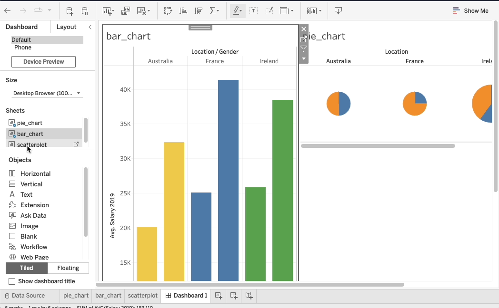{fig-align="center" style="max-height:450px;"}

## Dashboard Size {.smaller}

:::: {layout="[1.6,1]"}
::: {#first-column}

Set the size **before** placing anything, in the **Size** menu of the Dashboard pane:

- **Fixed size** (the default): the same on every screen, with scroll bars if the window is smaller. The safest choice for your assignment, e.g., 1200 × 800 px
- **Range**: between a minimum and a maximum size
- **Automatic**: fills the window, but the views can be squashed on a small screen

**Device Preview** shows the dashboard on a desktop, a tablet or a phone, and creates a layout for each device.

:::

::: {#second-column}

{fig-align="center" style="max-height:330px;"}

:::
::::

::: {style="font-size:0.5em;text-align:center;"}
Source: Size and Lay Out Your Dashboard, Tableau Help [](https://help.tableau.com/current/pro/desktop/en-us/dashboards_organize_floatingandtiled.htm)
:::

## Layout Containers {.smaller}

A **container** groups objects that resize together: a **Horizontal** container shares its width between them (e.g., a row of KPIs), a **Vertical** one its height (e.g., a column of filters).

:::: {layout="[1,1]"}
::: {#first-column}

{fig-align="center" style="max-height:160px;"}

::: {style="font-size:0.7em;text-align:center;"}
Horizontal: side by side
:::

:::

::: {#second-column}

{fig-align="center" style="max-height:160px;"}

::: {style="font-size:0.7em;text-align:center;"}
Vertical: one above the other
:::

:::
::::

- Drag a container from **Objects**, then drop the sheets inside it; **Distribute Evenly** gives them the same size
- **Tiled** objects share the space without overlapping; a **Floating** object sits on top, at a fixed position (hold  <kbd>Shift</kbd> /  <kbd>⇧ Shift</kbd> while dragging it)
- The **Layout** pane lists every object (the item hierarchy) and sets its position, size, background, border and padding

::: {style="font-size:0.5em;text-align:center;"}
Source: Size and Lay Out Your Dashboard, Tableau Help [](https://help.tableau.com/current/pro/desktop/en-us/dashboards_organize_floatingandtiled.htm)
:::

## Dashboard Objects {.smaller}

The **Objects** of the Dashboard pane add everything that is not a sheet:

{fig-align="center" style="max-height:150px;"}

:::: {layout="[1,1]"}
::: {#first-column}

- **Text**: the title, the story, the sources
- **Image**: a logo, an icon, a photo
- **Web Page**: a web page shown inside the dashboard
- **Blank**: space between objects

:::

::: {#second-column}

- **Navigation**: a button to another dashboard or sheet
- **Download**: a button to export the dashboard as a PDF, a PowerPoint or an image
- **Extension**: a feature added by a third party

:::
::::

Any object or container can get a **Show/Hide button**, e.g., to hide a panel of filters.

::: {style="font-size:0.5em;text-align:center;"}
Source: Create a Dashboard, Tableau Help [](https://help.tableau.com/current/pro/desktop/en-us/dashboards_create.htm)
:::

## Actions {.center .concept}

## Basic Actions {.smaller}

Filters and highlighters are set up in each sheet; **actions are set up in the dashboard**, and make all its figures react together.

:::: {layout="[1,1]"}
::: {#first-column}

{fig-align="center" style="max-height:300px;"}

:::

::: {#second-column}

Click **Dashboard** in the top toolbar → **Actions** → **Add Action**, then choose:

1. How to trigger the action: when the cursor goes over a figure (**Hover**), when it clicks on a figure (**Select**), or from an added menu (**Menu**)
2. Which figure it comes from
3. Which figures it changes

:::
::::

**Start with Filter and Highlight actions**: they behave like filters and highlighters, but for the full dashboard. The other actions take more set-up, but they are essential to add buttons, for instance.

::: {style="font-size:0.5em;text-align:center;"}
Source: Tableau Help [](https://help.tableau.com/current/pro/desktop/en-us/Img/Actions_dialog.png)
:::

## Global Filter and Highlight Actions {.smaller}

With the default settings, an action changes all the figures of the dashboard when the reader hovers over a figure, clicks on it, or selects a value from a menu.

:::: {layout="[1,1]"}
::: {#first-column}

- **Highlight actions** are **the easiest way to make a dashboard smart**: with **Hover** as the trigger, the figures react together as the cursor moves.

- **Filter actions** are useful too, but **confusing with Hover or Select** as the trigger, as the figures keep changing: trigger them from a **Menu** instead.

:::

::: {#second-column}

{fig-align="center" style="max-height:320px;"}

:::
::::

::: {style="font-size:0.5em;text-align:center;"}
Source: InterWorks [](https://interworks.com/wp-content/uploads/2019/02/GIF1.gif)
:::

## Use as Filter, and Other Actions {.smaller}

:::: {layout="[1.4,1]"}
::: {#first-column}

**The quickest filter action**: select a sheet on the dashboard and click its **Use as Filter** icon (a funnel). A click on one of its marks then filters all the other sheets.

**The other actions** of the **Actions** dialog:

- **Go to URL**: opens a web page, e.g., the post on Instagram
- **Go to Sheet**: moves to another sheet or dashboard
- **Change Parameter** and **Change Set Values**: a click changes a parameter or a set (advanced features)

:::

::: {#second-column}

{fig-align="center" style="max-height:320px;"}

:::
::::

::: {style="font-size:0.5em;text-align:center;"}
Source: Actions, Tableau Help [](https://help.tableau.com/current/pro/desktop/en-us/actions.htm)
:::

## Live Example: Building a Dashboard {.center .concept}

##  Your Turn! {background="#43464B" .smaller}

### Your Loomrow dashboard

One dashboard, fixed size 1200 × 800 px, to answer: **which format should Loomrow post more of, and why?**

1. Four sheets: percent of posts by `format`, box plots of `reach` by `format`, `reach` by month, return on ad spend by `country`
2. A title and a story: introduction, analysis, conclusion
3. A **Highlight** action on Hover, and a **Filter** action on Menu from the map

Start now, finish at home.

::: {#timer5_4 .timer seconds="600" starton="interaction"}
:::

## Publish

:::: {layout="[1.3,1]"}
::: {#first-column}

**Publishing** saves the dashboard online, where everyone can open it.

In Tableau Public in the browser, **publishing is saving**: click **Publish As...**, top right.

[]{style="color:#e34948;"} Warning: everything you publish is public, the data included.

For your assignment, publish your dashboard and submit its **URL** on Loop.

:::

::: {#second-column}

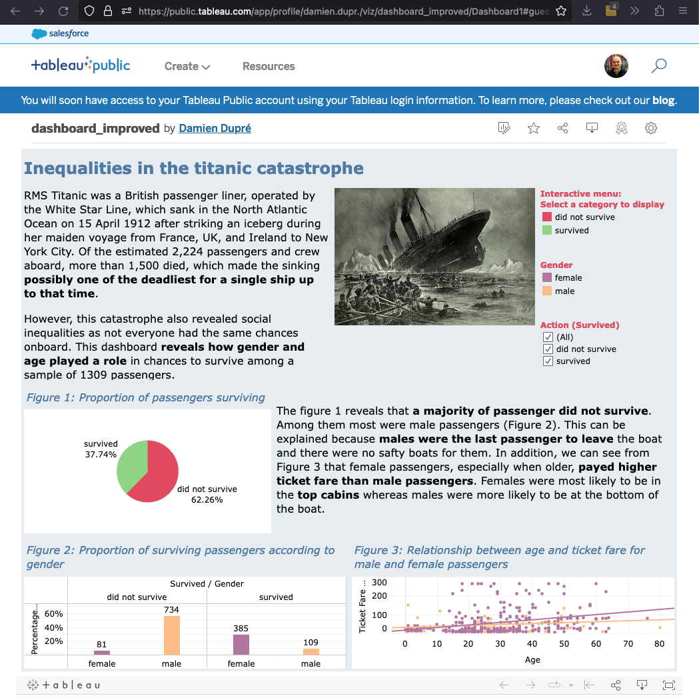{fig-align="center" style="max-height:400px;"}

:::
::::

## Learn More About Dashboards

More details about dashboards in Tableau, among other resources found online:

- [Best Practices for Effective Dashboards](https://help.tableau.com/current/pro/desktop/en-us/dashboards_best_practices.htm) by Tableau
- [Size and Lay Out Your Dashboard](https://help.tableau.com/current/pro/desktop/en-us/dashboards_organize_floatingandtiled.htm) by Tableau
- [Tableau Dashboard Workshop](https://ubc-library-rc.github.io/tableau-dashboard/) by UBC Library Research Commons (on GitHub)
- [Learning Data Visualization with Tableau](https://hfboyce.github.io/tableau_course/intro.html) by Hayley Boyce (on GitHub)
- [Dashboard Design Patterns](https://dashboarddesignpatterns.github.io/) by Bach and colleagues
- [Are You Making These 13 Dashboard Design Mistakes?](https://www.thedataschool.co.uk/anh-vu/are-you-making-these-13-dashboard-design-mistakes/) by The Data School

# 4. Assignment 1 Brief

## Assignment Instructions

### Context

You are the marketing analyst at an international company, just hired. Instagram is effectively the label's whole top of the funnel, and the founders want to know what 18 months of posts tell them.

### Task

With the data you will receive by email, **tell a story (i.e., a narrative) behind the data in ONE Tableau dashboard**, ending with a recommendation.

### Submission

Submit the URL of your Tableau Public dashboard on the STA1000 Loop page. **Deadline: November 22nd at 12pm midday**

## Tableau Objective

### Obtain the highest mark in Assignment 1

- Use **Tableau Public**, and submit the link to a **Dashboard** (not a Story)
- Work on each of the four assessment criteria (25% each):
  - **Creativity**: menus, filters and interactions that do something
  - **Analytical depth**: figures that answer a question worth asking
  - **Design**: layout, colour, typography, restraint
  - **Overall story**: title, narrative, and a conclusion with a recommendation
- Get inspired by existing dashboards on [Tableau Public](https://public.tableau.com/app/discover)

## Get Inspired

:::: {layout="[1.6,1]"}
::: {#first-column}

Past challenges are an excellent way to see outstanding dashboards:

- [Google Big Data Viz Challenge (2012)](https://www.tableau.com/big-data-viz-challenge-entries)
- [Do Good Data Viz Challenge (2016)](https://www.tableau.com/tableau-foundation-challenge)
- [Women in Analytics Data Viz Competition](https://www.dataconnectconf.com/previous-competitions)
- [Data Visualization Society, State of the Industry Challenge](https://www.datavisualizationsociety.org/soti-challenge)
- [Iron Viz](https://www.tableau.com/community/iron-viz), Tableau's own championship

:::

::: {#second-column}

{fig-align="center" style="max-height:330px;"}

:::
::::

## Keep Practising

:::: {layout="[1.2,1]"}
::: {#first-column}

- [Viz of the Day](https://public.tableau.com/app/discover/viz-of-the-day): a visualisation featured every weekday on Tableau Public
- [#MakeoverMonday](https://www.makeovermonday.co.uk/): every week, a dataset and a chart to remake
- [#WorkoutWednesday](https://www.workout-wednesday.com/): every week, a dashboard to rebuild, with its solution
- [Iron Viz: Student Edition](https://www.tableau.com/blog/iron-viz-student-edition): Tableau's competition for students

:::

::: {#second-column}

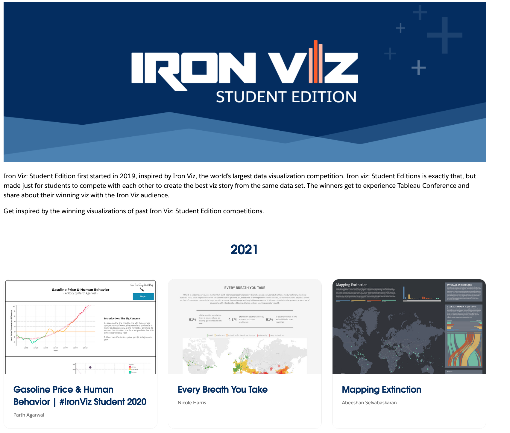{fig-align="center" style="max-height:400px;"}

:::
::::

## {background="#43464B"}

```{=html}
<style>img.circle {border-radius:50%;}</style>
```

:::: {layout="[1,1]"}
::: {#first-column}


:::
::: {#second-column}
**Thanks for your attention and don't hesitate to ask if you have any questions!**

[ @damien_dupre](https://datasci.social/@damien_dupre)

[ @damien-dupre](https://github.com/damien-dupre)

[ https://damien-dupre.github.io](https://damien-dupre.github.io)

[ damien.dupre@dcu.ie](mailto:damien.dupre@dcu.ie)
:::
::::
