## Previously ...

- In Lecture 4 we made figures clear and honest, then prepared the table behind them in Tableau: a pivot, calculated fields, and two files merged into one data source.

**Today, three questions:**

1. How does Tableau handle **dates** and **locations**?
2. How do you make a figure **interactive**?
3. How do you turn your figures into a **dashboard** where they work together?

# 1. Date and Location Types in Tableau

## Space and Time Variables

:::: {layout="[1.5,1]"}
::: {#first-column}

So far, two types of variables:

- **Categorical**, made of characters: the **Dimensions** in Tableau
- **Continuous**, made of numbers: the **Measures** in Tableau

Tableau has special features for two more types: **Date** variables, with a calendar icon, and **Location** variables, with a globe icon.

:::

::: {#second-column}

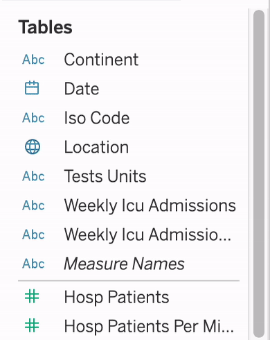{fig-align="center" style="width:100%; max-height:440px;"}

:::
::::

## Date Type Variables

A **date** refers to a specific time: any combination of year, month, day, hour, minute and second.

"March 23, 1984", "03/23/84", "23/03/1984" and "1984-03-23" have **different formats but refer to the same date**. Lecture 2: insist on **YYYY-MM-DD** (ISO 8601), which sorts correctly.

In `insta-data.csv`, `posted_at` (`2025-01-08 20:00:00`) should come in as a **Date & Time**, with a calendar icon. If it shows Abc or #, click the icon and choose **Date & Time**.

## Line and Area Charts

:::: {layout="[1.2,1]"}
::: {#first-column}

A date usually goes on **Columns**, the X axis, to show how another variable changes over time.

The other variable goes on **Rows**, with a **statistical aggregation**: SUM by default, but COUNT, AVERAGE or MEDIAN are in the menu of the pill.

Tableau starts with the **YEAR**: click the **+** on the date pill to go down to the quarter, the month, the day.

:::

::: {#second-column}

{fig-align="center" style="max-height:450px;"}

:::
::::

## One Date, Three Levels {.smaller}

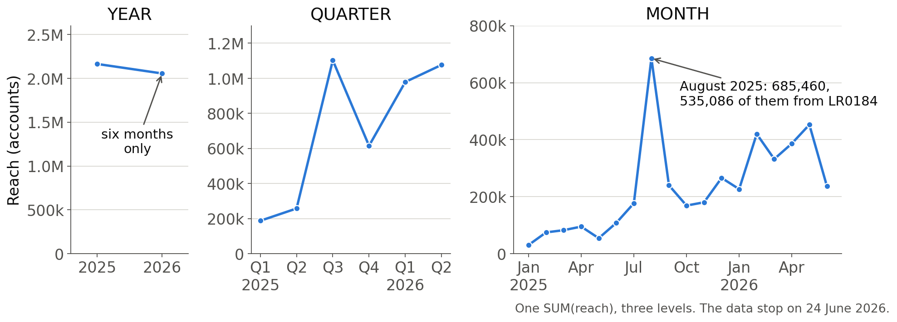{fig-align="center" style="max-height:330px;"}

The same `SUM(reach)` tells three stories. By **year**, 2026 looks like a decline, but it has only six months. By **quarter**, one quarter stands out. By **month**, it is one month, and mostly one post: Lecture 3's reel. **Check the level before you read the line.**

## Date Parts or Date Values?

:::: {layout="[1,1.4]"}
::: {#first-column}

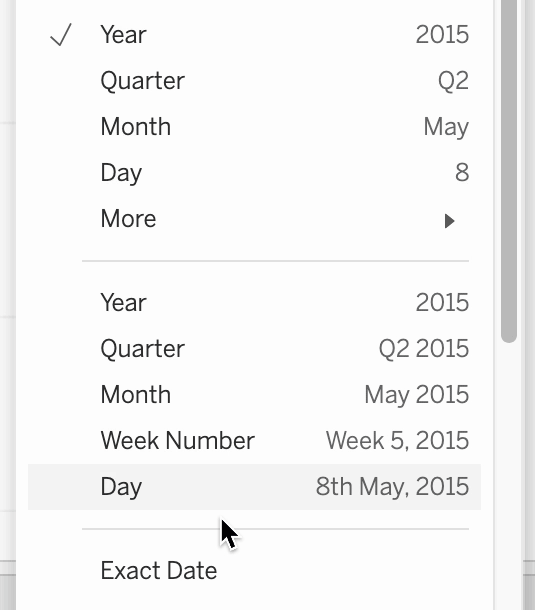{fig-align="center" style="max-height:450px;"}

:::

::: {#second-column}

The menu of a date pill ( right-click /  <kbd>⌃ Control</kbd> + click) has two lists:

**Date parts**, at the top: "May" means every May, whatever the year. The pill is **blue**, discrete.

**Date values**, below: "May 2015" means that month only. The pill is **green**, continuous: a timeline.

**Exact Date** keeps the full date and time of every row.

:::
::::

## Two Measures, One Chart {.smaller}

{fig-align="center" style="max-height:340px;"}

1. Drag a second measure onto **Rows**, next to the first: two charts, one above the other
2. Open the menu of the second pill → **Dual Axis**: one chart, with a second axis on the right

::: {style="font-size:0.7em;text-align:center;"}
The recordings in this lecture use a Covid-19 sample: the clicks are the same with your own data.
:::

## Synchronise the Axes

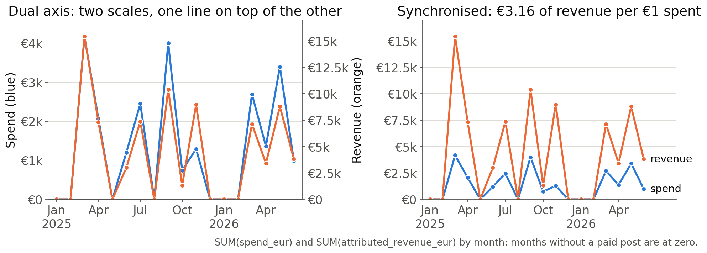{fig-align="center" style="max-height:290px;"}

With **Dual Axis**, each measure keeps its own scale: €4,170 of spend and €15,425 of revenue are drawn at the same height, the trick of Lecture 4's Nicolas Cage chart. When both measures share a unit, open the menu of the right axis → **Synchronise Axis**.

##  Your Turn! {background="#43464B"}

### Loomrow over time

With `insta-data.csv`:

1. Check that `posted_at` has a calendar icon
2. `reach` by month: which month peaks? Which Lecture 3 post explains it?
3. `spend_eur` and `attributed_revenue_eur` by month on a synchronised dual axis: how much revenue per euro spent?

::: {#timer5_1 .timer seconds="300" starton="interaction"}
:::

## Location Type Variables

A list of geographical places: continents, countries, regions, counties, cities, postcodes ...

A location variable should come in with a **globe icon**. If it shows Abc (text) or # (numbers, e.g., postcodes), click its icon → **Geographic Role** → **Country/Region**, **City**, ...

{fig-align="center" style="max-height:260px;"}

::: {style="font-size:0.5em;text-align:center;"}
Source: Get Started Mapping with Tableau [](https://help.tableau.com/current/pro/desktop/en-us/buildexamples_maps.htm)
:::

## Mapping with Tableau {.smaller}

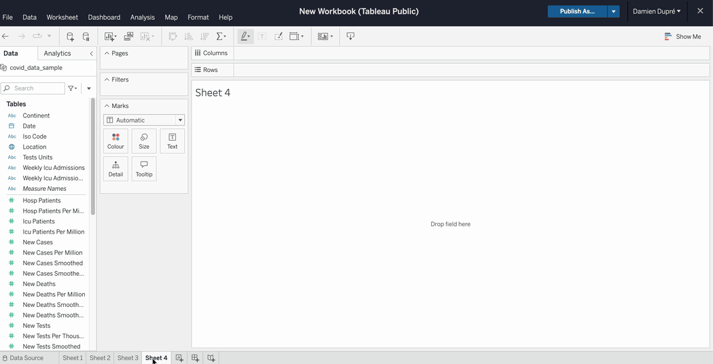{fig-align="center" style="max-height:330px;"}

1. Put the location variable on **Columns** or **Rows**, then open **Show Me**: Tableau generates the **Latitude** and **Longitude**
2. Choose a **symbol map**, where each place is a point (good for cities), or a **filled map**, where each place is filled with colour (not for cities)
3. Put another variable on **Colour** or **Size**

## Filled or Symbol Map?

Lecture 4: **land doesn't vote, people do**. A filled map gives the most ink to the largest area, whatever its value.

- A **count** (purchases, spend, followers): a **symbol map**, with the count on **Size**
- A **rate** (return on ad spend, conversion rate): a **filled map**, with the rate on **Colour**

::: {.fragment}
Maps are easy in Tableau: make one only when geography changes a decision.
:::

## A Second File, With Countries {.smaller}

`insta-data.csv` has no location, but Meta Ads Manager breaks the results of the 127 paid posts down by country: `ads-by-country.csv`, one row per post and country.

| post_id | country | amount_spent_eur | purchases | purchase_value_eur |
|---|---|---|---|---|
| LR0040 | Ireland | 202.33 | 8 | 877.84 |
| LR0040 | United Kingdom | 59.64 | 1 | 104.24 |
| LR0042 | Ireland | 93.82 | 5 | 507.76 |
| LR0042 | United Kingdom | 44.71 | 1 | 96.47 |

- Merge it with a **relationship** on `post_id`, as in Lecture 4: each table keeps its own rows
- Check the totals: `SUM(amount_spent_eur)` is €24,345.78, the `spend_eur` of `insta-data.csv`
- With a **join**, each paid post appears once per country: `SUM(spend_eur)` jumps to €106,899.36

##  Your Turn! {background="#43464B"}

### Map Loomrow's ads

From Loop, download `ads-by-country.csv`, then with `insta-data.csv`:

1. Relate the two files on `post_id`, and check the totals
2. `country` should have a globe icon: a symbol map of `purchases`. Where do the sales come from?
3. A filled map of the return on ad spend, `SUM([Purchase Value Eur]) / SUM([Amount Spent Eur])`: where does a euro go furthest?
4. Belgium and Italy: how many purchases behind them?

::: {#timer5_2 .timer seconds="420" starton="interaction"}
:::

# 2. Interactive Customisations in Tableau

## Aliases

An **alias** renames the categories a variable displays. Only the labels change: the original values are kept for the calculations.

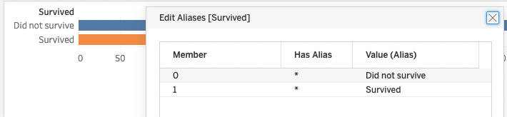{fig-align="center"}

In the Data pane, open the menu of a Dimension ( right-click /  <kbd>⌃ Control</kbd> + click) → **Aliases...**. Here, in a Titanic dataset, the 0 and 1 of `Survived` now read *Did not survive* and *Survived*.

## Tooltips {.smaller}

:::: {layout="[1,1.4]"}
::: {#first-column}

The **tooltip** is the box that appears when the cursor hovers over, or clicks on, a mark.

It gives the actual numbers behind the figure, and tells a short story about what is currently seen.

Edit it from **Tooltip** on the **Marks** card. Fields between `< >` change with the mark under the cursor.

:::

::: {#second-column}

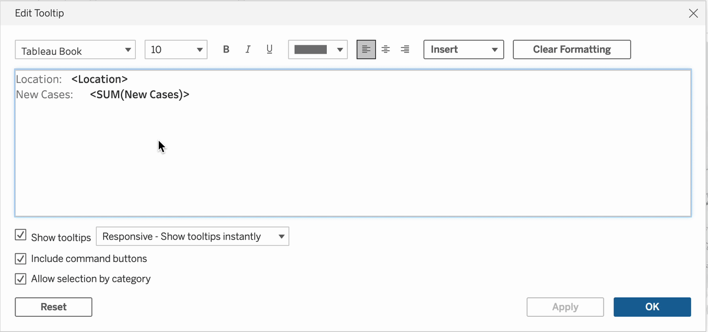{fig-align="center"}

:::
::::

## Write the Tooltip as a Sentence

:::: {layout="[1,1]"}
::: {#first-column}

**Default**, on `reach` by month:

::: {style="font-size:1.25em;"}
```
Month of Posted At:  August 2025
Reach:               685,460
```
:::

**Rewritten**:

::: {style="font-size:1.25em;"}
```
In <MONTH(Posted At)>,
<CNTD(Post Id)> posts reached
<SUM(Reach)> accounts. The best
one alone: <MAX(Reach)>.
```
:::

:::

::: {#second-column}

**Shows**:

*In August 2025, 26 posts reached 685,460 accounts. The best one alone: 535,086.*

<br>

To use a field that is not in the view, drag it onto **Tooltip** on the Marks card, then set its aggregation from the menu of its pill: **Count (Distinct)** for `post_id`, **Maximum** for `reach`.

:::
::::

## A Figure in the Tooltip {.smaller}

{fig-align="center" style="max-height:360px;"}

Instead of a value, a tooltip can show a whole figure: in the tooltip editor, **Insert** → **Sheets** → the sheet to show. Hover a country, and its own time series appears. With Loomrow: hover a month, and see its reach by `format`.

## Filters

Show **only specific data** with the **Filters** shelf: drag a variable onto it, then choose which categories to keep (Dimension) or which range of values (Measure).

{fig-align="center" style="max-height:320px;"}

::: {style="font-size:0.5em;text-align:center;"}
Source: Filter Data from Your Views, Tableau Help [](https://help.tableau.com/current/pro/desktop/en-us/filtering.htm)
:::

## Filter and Highlighter Menus {.smaller}

:::: {layout="[1,1.5]"}
::: {#first-column}

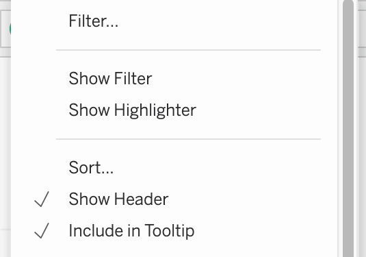{fig-align="center"}

:::

::: {#second-column}

A **menu** lets the reader make their own selection. Open the menu of a pill in the view:

- **Show Filter**: keeps the selected values and removes the others
- **Show Highlighter**: keeps every value and dims the ones not selected

Customise each card from its own drop-down arrow: list, drop-down, slider, ...

:::
::::

## Filter or Highlight? {.smaller}

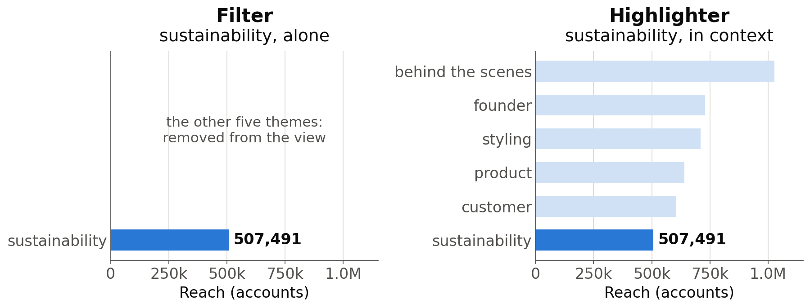{fig-align="center" style="max-height:370px;"}

The **filter** leaves sustainability alone: 507,491 accounts, but is that a lot? The **highlighter** keeps the other themes, dimmed: sustainability is the lowest of the six.

**Filter** when the rest of the data does not matter, **highlight** when the comparison with the rest does.

::: {style="font-size:0.5em;text-align:center;"}
Source: Highlight Data Points in Context, Tableau Help [](https://help.tableau.com/current/pro/desktop/en-us/actions_highlight_highlighter.htm). To go further: Highlight vs Filter Actions in Tableau: When Should You Use Each?, Andy Kriebel (video) [](https://www.youtube.com/watch?v=Ezq644Th3SM)
:::

## Time Animation Player {.smaller}

Put a date on the **Pages** shelf: the view becomes a series of pages, one per month (or year, or day), with **playback controls** to play them in a row.

{fig-align="center" style="max-height:300px;"}

Tick **Show History** to keep the marks of the previous pages on screen. With Loomrow: `impressions` against `likes`, and `posted_at` as a month on **Pages**.

::: {style="font-size:0.5em;text-align:center;"}
Source: Shelves and Cards Reference, Tableau Help [](https://help.tableau.com/current/pro/desktop/en-us/buildmanual_shelves.htm)
:::

##  Your Turn! {background="#43464B"}

### Make your figures smart

On your Loomrow sheets:

1. Alias `is_paid`: **False** as Organic, **True** as Paid
2. Rewrite the tooltip of `reach` by month as a sentence
3. `reach` by `theme`: a filter on `theme`, then a highlighter. Select customer in each: where does it rank?
4. Your scatterplot, by month on **Pages**: press play

::: {#timer5_3 .timer seconds="360" starton="interaction"}
:::

# 3. Tableau Dashboard

## Tableau Dashboard Showcase

Federica Pinza's visualisation, DCU winner of the 2024 European Data Visualisation Challenge organised by EDHEC

{fig-align="center" style="max-height:430px;"}

## Tableau Dashboard Showcase

:::: {layout="[1,1.6]"}
::: {#first-column}

{fig-align="center"}

:::

::: {#second-column}

[ Link to the dashboard](https://public.tableau.com/app/profile/federica.pinza/viz/Aglobalfightforgenderequalityineducation/Dashboard1)

One long page, read from top to bottom:

- a headline and the key numbers
- a map, a trend and a correlation
- the causes, explained with icons and text
- a conclusion with a call to action

:::
::::

## Nice Interactions and Design

{fig-align="center"}

{fig-align="center" style="max-height:250px;"}

## Meaningful Visualisations

{fig-align="center" style="max-height:275px;"}

{fig-align="center" style="max-height:210px;"}

## Insightful Storytelling

{fig-align="center"}

{fig-align="center" style="max-height:370px;"}

## Example Not to Follow! {.smaller}

{fig-align="center" style="max-height:320px;"}

::: {.fragment}
- Typos in the titles: "Wold", "Countires"
- One colour per country on the map, and a pie with one slice per country: the colours carry no information
- Raw field names as axis titles ("Obs Value"), two different fonts, and two bar charts on different scales
- No text to say what the index measures, or what to conclude
:::

## Design Strategy

Creating a perfect Tableau dashboard is easy if you follow these steps:

1. **Basic figures**: create many figures that can support your story, and leave them with all their default parameters
2. **Basic dashboard**: put the most relevant figures in a dashboard, with its title, text and pictures, but no design work yet
3. **Figure improvement**: go back to the worksheet of each figure and customise it: colour, size, shapes, title, captions, axes and interactions
4. **Dashboard improvement**: go back to the dashboard and customise it: background, colours, fonts, layout and actions

## Tableau Dashboard

A dashboard is made by dropping several **sheets** on a page, organising their position, and adding **objects** (text, images, blank space, ...).

Design features can then be changed to give the dashboard a professional feel.

Interactions that make all the sheets move together come with step 4: the dashboard actions.

## Tableau Dashboard {.smaller}

{fig-align="center" style="max-height:450px;"}

Drag the sheets from the left panel onto the page. **Tiled** keeps them in a tidy grid; **Floating** lets an object sit on top of the others.

## Dashboard Actions {.smaller}

On a dashboard, a highlighter already works on every sheet with the same variable, but a filter only on its own sheet (to extend it: its menu on the **Filters** shelf → **Apply to Worksheets** → **All Using This Data Source**). **Actions** go further: they make all the figures react together.

:::: {layout="[1,1.2]"}
::: {#first-column}

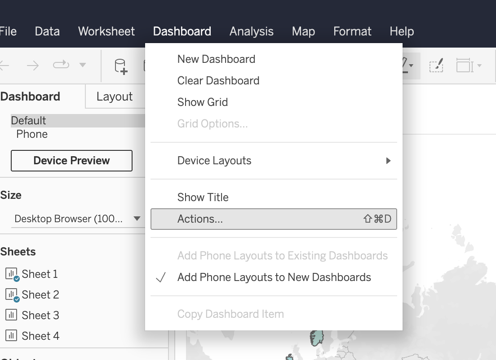{fig-align="center"}

:::

::: {#second-column}

**Dashboard** → **Actions...** → **Add Action**, then choose:

1. what triggers it: **Hover**, **Select** (a click) or **Menu**
2. which sheet it comes from
3. which sheets it changes

A **Highlight** action on Hover is the easiest way to make a dashboard smart. A **Filter** action on Hover or Select changes the figures under the reader's eyes: prefer **Menu**.

:::
::::

##  Your Turn! {background="#43464B" .smaller}

### Your Loomrow dashboard

Four sheets, two from Lecture 3 and two from today:

- **Composition**: percent of posts by `format`
- **Comparison**: box plots of `reach` by `format`
- **Time**: `reach` by month
- **Map**: return on ad spend by `country`

Titles that state the finding, and a text box: **which format should Loomrow post more of, and why?**

Then two actions: a **Highlight** on Hover from the composition sheet, and a **Filter** on Menu from the map. Start now, finish at home.

::: {#timer5_4 .timer seconds="600" starton="interaction"}
:::

## Publish

**Publishing** saves a dashboard online, for everybody to open. In Tableau Public in the browser, **publishing is saving**: **Publish As...**, top right.

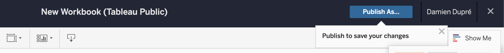{fig-align="center" style="max-height:80px;"}

:::: {layout="[1.3,1]"}
::: {#first-column}

[]{style="color:#e34948;"} **Everything you publish is public**, the data included.

On the published page, **Share** gives the link; **Download** gives an image, a PDF, or the workbook with its data (`.twbx`).

[]{style="color:#e34948;"} For your assignment, publish your dashboard and submit its **URL** on Loop.

:::

::: {#second-column}

{fig-align="center" style="max-height:290px;"}

:::
::::

# 4. Assignment 1 Brief

## Assignment Instructions

### Context

You are the marketing analyst at an international company, just hired. Instagram is effectively the label's whole top of the funnel, and the founders want to know what 18 months of posts tell them.

### Task

With the data you will receive by email, **tell a story (i.e., a narrative) behind the data in ONE Tableau dashboard**, ending with a recommendation.

### Submission

Submit the URL of your Tableau Public dashboard on the STA1000 Loop page. **Deadline: November 22nd at 12pm midday**

## Tableau Objective

### Obtain the highest mark in Assignment 1

- Use **Tableau Public**, and submit the link to a **Dashboard** (not a Story)
- Work on each of the four assessment criteria (25% each):
  - **Creativity**: menus, filters and interactions that do something
  - **Analytical depth**: figures that answer a question worth asking
  - **Design**: layout, colour, typography, restraint
  - **Overall story**: title, narrative, and a conclusion with a recommendation
- Get inspired by existing dashboards on [Tableau Public](https://public.tableau.com/app/discover)

## Get Inspired

Past challenges are an excellent way to see outstanding dashboards:

- [Google Big Data Viz Challenge (2012)](https://www.tableau.com/big-data-viz-challenge-entries)
- [Do Good Data Viz Challenge (2016)](https://www.tableau.com/tableau-foundation-challenge)
- [Women in Analytics Data Viz Competition](https://www.dataconnectconf.com/previous-competitions)
- [Data Visualization Society, State of the Industry Challenge](https://www.datavisualizationsociety.org/soti-challenge)
- [Iron Viz](https://www.tableau.com/community/iron-viz), Tableau's own championship

{fig-align="center" style="max-height:200px;"}

## {background="#43464B"}

```{=html}
<style>img.circle {border-radius:50%;}</style>
```

:::: {layout="[1,1]"}
::: {#first-column}


:::
::: {#second-column}
**Thanks for your attention and don't hesitate to ask if you have any questions!**

[ @damien_dupre](https://datasci.social/@damien_dupre)

[ @damien-dupre](https://github.com/damien-dupre)

[ https://damien-dupre.github.io](https://damien-dupre.github.io)

[ damien.dupre@dcu.ie](mailto:damien.dupre@dcu.ie)
:::
::::
