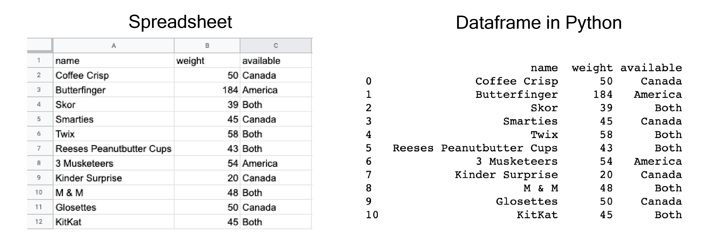
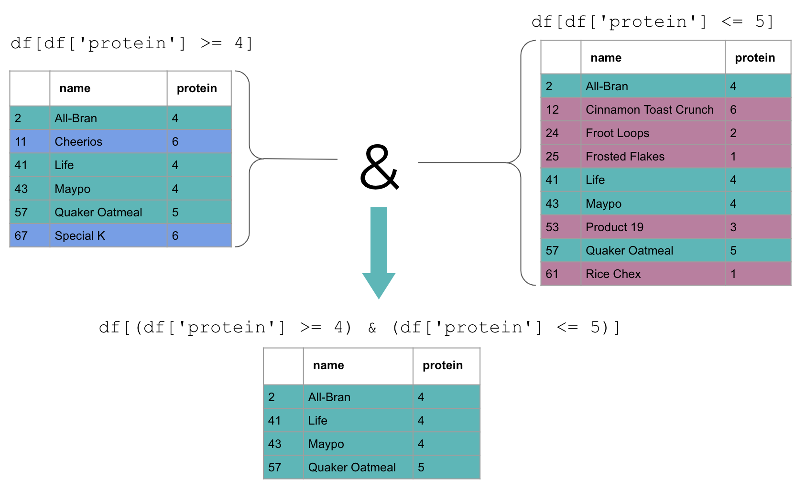

```{python}
#| include: false
# The slides read the repository copy of the data; students read the file they
# uploaded to Colab, which is the code shown on the slides.
import pandas as pd
pd.set_option("display.max_columns", 7)
pd.set_option("display.max_rows", 8)
pd.set_option("display.width", 80)
insta = pd.read_csv("../data/insta-data.csv")
```

## Previously ...

- In Lecture 6 you wrote your first lines of Python in Colab: variables, types, comparisons, and errors read from their last line.

**Today, three questions:**

1. How do you **open** a table with pandas, and **look** at it?
2. How do you **select** columns, **filter** rows and **sort** them?
3. How do you **add** a column, and **save** the result?

# 1. Open a Table with pandas

## From Spreadsheet to DataFrame

{fig-align="center" style="max-height:260px;"}

::: {style="font-size:0.5em;text-align:center;"}
Source: UBC Master of Data Science, Programming in Python for Data Science [](https://prog-learn.mds.ubc.ca/)
:::

pandas calls a table a **DataFrame**: a spreadsheet with one row per observation, one column per variable, a type for each column, and no hidden formulas.

## pandas

**pandas** is the Python library for tables. `import pandas as pd` loads it under the short name `pd`, which every example online and every AI answer assumes. Everything you clicked in Tableau has its line:

::: {style="font-size:0.6em; line-height:1.3;"}

| In Tableau | In pandas | When |
|---|---|---|
| Connect to a text file | `pd.read_csv("insta-data.csv")` | Today |
| The Abc, # and calendar icons | `insta.info()` | Today |
| The Filters shelf | `insta[insta["format"] == "reel"]` | Today |
| A calculated field | `insta["rate"] = insta["likes"] / insta["reach"]` | Today |
| A dimension on Rows, `SUM` of a measure | `insta.groupby("format")["reach"].sum()` | Lecture 8 |
| A relationship, or a join | `pd.merge(posts, ads, on="post_id", how="left")` | Lecture 8 |
| Show Me | `insta["format"].value_counts().plot(kind="bar")` | Lecture 9 |

:::

Every pandas command starts with `pd.` or with the name of a table, and works on **whole columns at once**.

## Today's Notebook

A new notebook, `STA1000 Lecture 7`. Python runs on Google's computer, and your file is on your laptop: the file has to be **uploaded to the runtime** first.

1. From Loop, download `insta-data.csv`
2. In Colab, click the  **Files** icon in the left sidebar
3. Drag the file into the panel, or use its upload button
4. It appears in the list: Python can now read it by its name

[]{style="color:#e34948;"} **Uploaded files are deleted with the runtime.** Next session, upload them again.

## Read the File

In the first cell:

```{.python}
import pandas as pd
insta = pd.read_csv("insta-data.csv")
```

- `pd.read_csv()` reads a CSV file into a DataFrame
- `insta =` stores that table under a name of your choice. From now on, `insta` **is** the table
- The name of the file goes **between quotes**, exactly as it is spelt in the Files panel

Nothing is shown: `=` stores, it does not display. To see the table, run its name.

## Show the Table

```{python}
insta
```

The 431 posts of Lectures 2 to 5, in Python: Colab shows the first and last rows, and the size underneath. The first cell of every notebook loads pandas and reads the file: **Runtime** → **Restart session and run all** should always bring you back here.

## When the File Is Not Found

```
FileNotFoundError: [Errno 2] No such file or directory: 'insta_data.csv'
```

The last line means exactly what it says. Four checks:

1. Is the file in the **Files** panel? Upload it again after every restart
2. Is the name spelt **exactly**? Here the file is `insta-data.csv`, with a hyphen
3. Is the **extension** there? Windows and macOS hide it, Python does not: `insta-data` is not `insta-data.csv`
4. Colab runs on Linux, where **capitals matter**: `Insta-data.csv` is another file

Better than checking:  right-click /  <kbd>⌃ Control</kbd> + click on the file in the Files panel → **Copy path**, and paste it between the quotes.

## Rows, Columns, Names

```{python}
insta.shape
```

```{python}
insta.head(3)
```

- `.shape`: the number of rows, then of columns
- `.head()`: the first 5 rows, or as many as you ask for. `.tail()`: the last ones
- `.columns`: the names of the columns

## The Type of Each Column

:::: {layout="[1.1,1]"}
::: {#first-column}

```{.python}
insta.info()
```

```
 #   Column           Non-Null Count  Dtype
---  ------           --------------  -----
 0   post_id          431 non-null    object
 1   posted_at        431 non-null    object
 2   format           431 non-null    object
 ...
 5   campaign         206 non-null    object
 6   is_paid          431 non-null    bool
 ...
 10  reach            431 non-null    int64
 ...
 23  spend_eur        431 non-null    float64
```

:::

::: {#second-column}

::: {style="font-size:0.75em; line-height:1.3;"}

| pandas | Lecture 6 | Tableau |
|---|---|---|
| `object`: text | `str` | Abc |
| `int64`: whole numbers | `int` | # |
| `float64`: decimals | `float` | # |
| `bool`: True or False | `bool` | T\|F |
| `datetime64`: dates | | calendar |

Newer versions of pandas write `str` for text.

**Non-Null Count**: `campaign` has 206 values out of 431. The 225 others are **missing**: Lecture 8 comes back to them.

:::

:::
::::

## One Column

```{python}
insta["reach"]
```

- The name of the table, square brackets, and the name of the column in quotes
- Spelt **exactly** as in the file: `insta["Reach"]` fails, the column is `reach`
- One column is a **Series**: its values, with the row numbers on their left

## The Key Figures of a Column

```{python}
insta["reach"].describe()
```

Lecture 3's key figures in one line. The mean (9,788) is almost twice the median (5,184): a few huge posts pull it up, starting with LR0184 and its 535,086 accounts.

One at a time: `.mean()`, `.median()`, `.sum()`, `.min()`, `.max()`. A cell shows only its **last** result: to see several, wrap each in `print()`.

## Count the Categories

```{python}
insta["format"].value_counts()
```

```{python}
insta["format"].value_counts(normalize=True)
```

`normalize=True` turns the counts into proportions, Lecture 3's composition: 47% of the posts are reels.

## The Five Lines You Always Run

```{.python}
insta.head()                      # what does a row look like?
insta.shape                       # how big is the table?
insta.info()                      # the type of each column, and what is missing
insta["reach"].describe()         # the key figures of a number
insta["format"].value_counts()    # the categories of a text column
```

**Never analyse a table you have not looked at.** Most analytical errors are a wrong assumption about the data, made in the first five minutes.

##  Your Turn! {background="#43464B"}

### A first look at Loomrow

Start from your first cell, which reads the file. Then type each block in its own code cell, and run it:

```{.python}
# 1. rows and columns
insta.shape

# 2. the type of each column, in the Dtype column
insta.info()

# 3. the mean and the median of the likes
print(insta["likes"].mean())
print(insta["likes"].median())

# 4. the share of the posts in each product line
insta["product_line"].value_counts(normalize=True)

# 5. the revenue for each euro spent on ads
insta["attributed_revenue_eur"].sum() / insta["spend_eur"].sum()
```

::: {#timer7_1 .timer seconds="360" starton="interaction"}
:::

## Solution

```{python}
print(insta.shape)
print(insta["likes"].mean())
print(insta["likes"].median())
```

`.info()`: 6 text columns, `posted_at` among them until Lecture 8 turns it into a date; 19 numbers; and `is_paid`, True or False. Mean 463 against median 278 likes: a few huge posts pull the mean up, the same skew as reach.

## Solution (continued)

```{python}
print(insta["product_line"].value_counts(normalize=True))
print(insta["attributed_revenue_eur"].sum() / insta["spend_eur"].sum())
```

The five product lines share the posts almost equally, 18% to 21% each. And €3.16 of revenue for each euro spent, as you computed by hand in Lecture 6.

# 2. Select, Filter, Sort

## Several Columns

```{python}
insta[["post_id", "format", "reach"]]
```

- `["post_id", "format", "reach"]` is a **list**: several values between square brackets, separated by commas
- The outer pair of brackets selects. **One** pair gives one column; **two** pairs, a list inside, give a table

## Comparison Operators

| Operator | Meaning |
|:--|:--|
| `==` | equal to |
| `!=` | not equal to |
| `>` `<` | greater than, less than |
| `>=` `<=` | greater or equal, less or equal |

[]{style="color:#e34948;"} **`=` stores, `==` compares.** Mixing them up happens to everyone.

Lecture 6 compared one value at a time. On a column, pandas compares every row at once: one `True` or `False` per post.

## Filter the Rows

```{python}
reels = insta[insta["format"] == "reel"]
reels.shape
```

- `insta["format"] == "reel"` is Lecture 6's comparison, made for every row: True or False. `insta[...]` keeps the rows where it is True
- The **Filters** shelf of Tableau, written down
- `==` compares, `=` stores: `insta["format"] = "reel"` would replace every format with "reel"

## What `&` Does

{fig-align="center" style="max-height:360px;"}

::: {style="font-size:0.5em;text-align:center;"}
Source: UBC Master of Data Science, Programming in Python for Data Science [](https://prog-learn.mds.ubc.ca/)
:::

Each condition keeps some rows; `&` keeps only the rows **both** conditions keep.

## Two Conditions at Once

```{python}
insta[(insta["format"] == "reel") & (insta["reach"] > 50000)]
```

- `&` keeps the rows where **both** conditions are True; `|` where **either** is
- Each condition in its **own brackets**. Without them, Python reads `"reel" & insta["reach"]` first, and fails

## Sort the Rows

```{python}
top = insta.sort_values("reach", ascending=False)
top[["post_id", "posted_at", "format", "reach"]].head(5)
```

`ascending=False` puts the largest first. Lecture 3's reel, LR0184, tops the list with a reach almost four times the next one.

##  Your Turn! {background="#43464B"}

### Question the posts

Type each block in its own code cell, and run it:

```{.python}
# 1. the five posts with the largest reach
top = insta.sort_values("reach", ascending=False)
top[["post_id", "format", "product_line"]].head(5)

# 2. the number of paid posts, and their median reach
paid = insta[insta["is_paid"] == True]
print(paid.shape)
print(paid["reach"].median())

# 3. the reels that reached more than 50,000 accounts, by product line
big_reels = insta[(insta["format"] == "reel") & (insta["reach"] > 50000)]
big_reels["product_line"].value_counts()
```

::: {#timer7_2 .timer seconds="420" starton="interaction"}
:::

## Solution

```{python}
top = insta.sort_values("reach", ascending=False)
print(top[["post_id", "format", "product_line"]].head(5))
paid = insta[insta["is_paid"] == True]
print(paid.shape, paid["reach"].median())
big_reels = insta[(insta["format"] == "reel") & (insta["reach"] > 50000)]
print(big_reels["product_line"].value_counts())
```

## Solution (continued)

- Accessories has two of the five largest posts, both reels: LR0184 and LR0402
- 127 paid posts, with a median reach of 5,585: barely more than the 5,184 of all posts
- Three reels above 50,000: two Accessories, one Knitwear. Only one of the three was paid

A filter keeps a **copy**: `insta` still holds all 431 posts. Nothing you filter or sort is lost.

# 3. Add a Column, Save a Table

## A New Column

```{python}
insta["engagements"] = insta["likes"] + insta["comments"] + insta["saves"] + insta["shares"]
insta[["post_id", "likes", "comments", "saves", "shares", "engagements"]].head(3)
```

- A **calculated field**, as in Tableau: the formula applies to every row at once, with no loop
- The name on the left is yours: if it does not exist yet, the column is added at the end of the table

## A Rate

```{python}
insta["engagement_rate"] = insta["engagements"] / insta["reach"] * 100
insta[["post_id", "format", "engagements", "reach", "engagement_rate"]].head(3)
```

`+`, `-`, `*` and `/` work between columns, or with a number: `* 100` gives a percentage, and `insta["reach"] / 1000` gives the reach in thousands.

## Keep a Result, Save a Result

```{.python}
paid = insta[insta["is_paid"] == True]
paid.to_csv("paid-posts.csv", index=False)
```

- `paid =` keeps the result under a new name. `insta` is unchanged
- `.to_csv()` writes the table as a file in the Files panel:  right-click /  <kbd>⌃ Control</kbd> + click on it → **Download**
- `index=False` stops pandas writing its row numbers as an extra column

##  Your Turn! {background="#43464B"}

### Calculated fields

Type each block in its own code cell, and run it:

```{.python}
# 1. two new columns
insta["engagements"] = insta["likes"] + insta["comments"] + insta["saves"] + insta["shares"]
insta["engagement_rate"] = insta["engagements"] / insta["reach"] * 100

# 2. the three posts with the highest engagement rate
top = insta.sort_values("engagement_rate", ascending=False)
top[["post_id", "format", "reach", "engagement_rate"]].head(3)

# 3. the paid posts, four of their columns, saved as a file
paid = insta[insta["is_paid"] == True]
paid = paid[["post_id", "format", "spend_eur", "attributed_revenue_eur"]]
paid.to_csv("paid-posts.csv", index=False)
```

Then download `paid-posts.csv` from the **Files** panel.

::: {#timer7_3 .timer seconds="420" starton="interaction"}
:::

## Solution

```{python}
top = insta.sort_values("engagement_rate", ascending=False)
print(top[["post_id", "format", "reach", "engagement_rate"]].head(3))
paid = insta[insta["is_paid"] == True]
paid = paid[["post_id", "format", "spend_eur", "attributed_revenue_eur"]]
```

```{.python}
paid.to_csv("paid-posts.csv", index=False)
```

The top two rates come from tiny posts: 403 and 616 accounts reached. **A rate needs its denominator next to it**: Lecture 8 comes back to it.

# 4. When It Breaks

## Read the Last Line

Lecture 6's rule holds for tables: Python stops at the first problem, and the **last line** of the error names it.

```
KeyError                                  Traceback (most recent call last)
...
KeyError: 'Reach'
```

Skip the middle. Here, there is no column called `Reach`. The column is `reach`.

## Five Errors You Will Meet Today {.smaller}

| The last line says | What happened | The fix |
|---|---|---|
| `NameError: name 'insta' is not defined` | The cell that creates `insta` was not run, or the runtime restarted | Run the cells from the top |
| `KeyError: 'Reach'` | No column with that exact name | Copy the name from `insta.columns` |
| `FileNotFoundError: ... 'insta_data.csv'` | The file is not in the Files panel, or the name differs | Upload it again; copy its name |
| `SyntaxError: ... Maybe you meant '==' instead of '='?` | A bracket, a quote, or a `=` for `==` | Python often suggests the fix: read it |
| `TypeError: Cannot perform 'rand_' with a dtyped [int64] array ...` | Two conditions joined by `&` without their brackets | One pair of brackets around each condition |

##  Your Turn! {background="#43464B"}

### Break it, fix it

Each line holds **one** mistake. Type each line in its own code cell, exactly as it is:

```{.python}
insta = pd.read_csv("insta_data.csv")
insta["Reach"].median()
insta[insta["format"] = "image"]
insta[insta["format"] == "reel" & insta["reach"] > 50000]
```

1. Run each cell, and read the **last line** of its error
2. Fix the mistake, and run it again until it works

::: {#timer7_4 .timer seconds="300" starton="interaction"}
:::

## Solution

| Line | Error | The fix |
|:--|:--|:--|
| 1 | `FileNotFoundError` | a hyphen: `"insta-data.csv"` |
| 2 | `KeyError` | lower case: `"reach"` |
| 3 | `SyntaxError` | `==` to compare |
| 4 | `TypeError` | brackets around each condition |

```{.python}
insta = pd.read_csv("insta-data.csv")
insta["reach"].median()
insta[insta["format"] == "image"]
insta[(insta["format"] == "reel") & (insta["reach"] > 50000)]
```

## {background="#43464B"}

```{=html}
<style>img.circle {border-radius:50%;}</style>
```

:::: {layout="[1,1]"}
::: {#first-column}


:::
::: {#second-column}
**Thanks for your attention and don't hesitate to ask if you have any questions!**

[ @damien_dupre](https://datasci.social/@damien_dupre)

[ @damien-dupre](https://github.com/damien-dupre)

[ https://damien-dupre.github.io](https://damien-dupre.github.io)

[ damien.dupre@dcu.ie](mailto:damien.dupre@dcu.ie)
:::
::::
