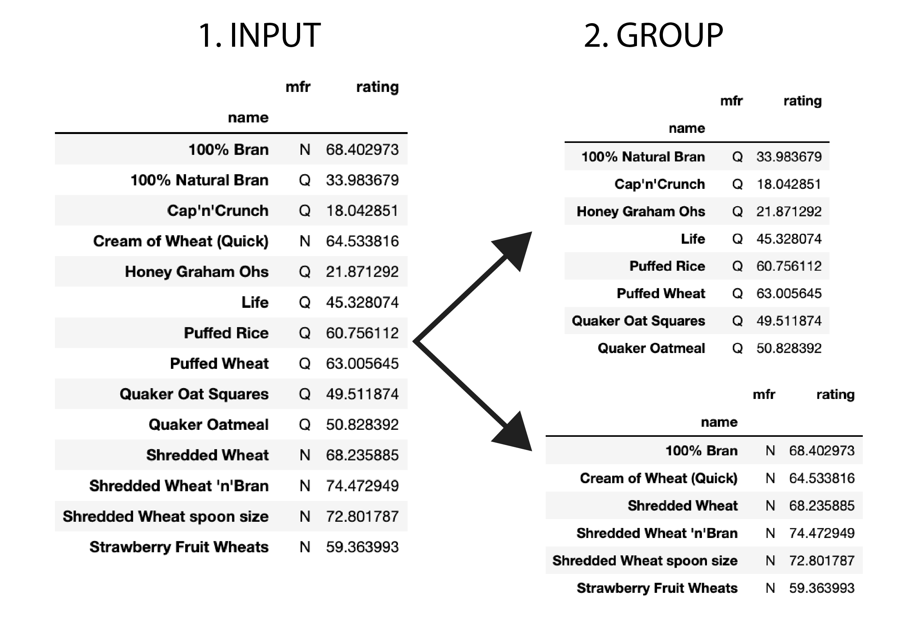

```{python}
#| include: false
# The slides read the repository copy of the data; students read the file they
# uploaded to Colab, which is the code shown on the slides.
# A two-column layout drops the code of an executed chunk and keeps only its
# output: in a column, the code is shown as a ```{.python} block, and a hidden
# chunk below it runs the same lines.
import pandas as pd
pd.set_option("display.max_columns", 7)
pd.set_option("display.max_rows", 8)
pd.set_option("display.width", 80)
insta = pd.read_csv("../data/insta-data.csv")
```

## Previously ...

- In Lecture 6 you wrote your first lines of Python in Colab: variables, types, comparisons, and errors read from their last line.

**Today, four questions:**

1. How do you **open** a table, and take a **first look** at it?
2. How do you keep only the **columns** and the **rows** a question needs, and **sort** them?
3. How do you **create** a column, and **save** the result?
4. How do you **group** the rows, and **summarise** each group?

## pandas and DataFrames

**pandas** is Python's library for tables, and a table in pandas is a **DataFrame**.

{fig-align="center" style="max-height:190px;"}

::: {style="font-size:0.5em;text-align:center;"}
Source: UBC Master of Data Science, Programming in Python for Data Science [](https://prog-learn.mds.ubc.ca/)
:::

- Named columns, and rows labelled by an **index**
- One column on its own: a **Series**
- Every pandas command works on **whole columns at once**

## Five Operations

Almost every data question needs only five operations, and you have done all five in Tableau:

::: {style="font-size:0.7em; line-height:1.3;"}

| Operation | What it does | In Tableau | In pandas |
|:-------------|:------------------|:----------------------|:-----------------------------------------------|
| **Selection** | keeps columns | the fields you drag in | `insta[["format", "reach"]]` |
| **Reduction** | keeps rows | the Filters shelf | `insta[insta["format"] == "reel"]` |
| **Extension** | adds a column | a calculated field | `insta["rate"] = insta["likes"] / insta["reach"]` |
| **Aggregation** | a row per group | `SUM` by a dimension | `insta.groupby("format")["reach"].sum()` |
| **Combination** | joins two tables | a relationship or a join | `pd.merge(posts, ads, on="post_id", how="left")` |

:::

Today, a first look at the table, then the first four operations, one section each. Lecture 8 does the last one, with rates per group and dates, and Lecture 9 draws the results.

## Today's Notebook

A new notebook, `STA1000 Lecture 7`. Python runs on Google's computer, and your file is on your laptop: the file has to be **uploaded to the runtime** first.

1. From Loop, download `insta-data.csv`
2. In Colab, click the  **Files** icon in the left sidebar
3. Drag the file into the panel, or use its upload button
4. It appears in the list: Python can now read it by its name

[]{style="color:#e34948;"} **Uploaded files are deleted with the runtime.** Next session, upload them again.

# 1. A First Look

## Loading pandas

In the first cell of every notebook:

```{.python}
import pandas as pd
```

- `import` loads a **library**, ready-made code for one job: here, tables. Colab has pandas installed already
- `as pd` gives it a short name: every pandas command then starts with `pd.`, as in `pd.read_csv()`. Use exactly `pd`: every example online assumes it

::: {style="font-size:0.8em;"}

| You see | Why |
|:--------------------------|:--------------------------|
| `ModuleNotFoundError: No module named 'panda'` | a typo: `pandas`, with an s |
| `NameError: name 'pd' is not defined` | the first cell has not run since the session started: run it |

:::

## Reading a CSV File

A **CSV** file is a table written as text (Lecture 2): names on the first line, one row per line, commas between the values. The start of `insta-data.csv`:

```{.default}
post_id,posted_at,format,product_line,theme,campaign,is_paid,...
LR0001,2025-01-08 20:00:00,reel,Knitwear,styling,,False,...
LR0002,2025-01-08 12:00:00,reel,Knitwear,customer,,False,...
```

```{.python}
insta = pd.read_csv("insta-data.csv")    # first cell, after the import
```

- `pd.read_csv()` reads the text into a **DataFrame**, with a type for each column. The file's name goes **between quotes**, spelt as in the Files panel
- `insta =` stores the table under a name of your choice. Nothing is shown: `=` stores, it does not display
- Semicolon files: `pd.read_csv("file.csv", sep=";")`. Excel files: `pd.read_excel("file.xlsx")`

## When the File Is Not Found

```
FileNotFoundError: [Errno 2] No such file or directory: 'insta_data.csv'
```

The last line means exactly what it says. Four checks:

1. Is the file in the **Files** panel? A new runtime starts empty: upload it again
2. Is the name spelt **exactly**? Here the file is `insta-data.csv`, with a hyphen
3. Is the **extension** there? Windows and macOS hide it, Python does not: `insta-data` is not `insta-data.csv`
4. Colab runs on Linux, where **capitals matter**: `Insta-data.csv` is another file

Better than checking:  right-click /  <kbd>⌃ Control</kbd> + click on the file in the Files panel → **Copy path**, and paste it between the quotes.

## The Loomrow Dataset

Each row is **a post** on Loomrow's Instagram account, January 2025 to June 2026: its `format`, `theme`, `reach`, `likes`, `saves`, ad spend and revenue.

```{python}
insta.head(3)
```

- `.head(3)`: the first 3 rows; `.tail(3)`: the last 3; `insta` alone: the first and last five, and the size
- **Runtime** → **Restart session and run all** reruns the first cell, and brings you back here

## Rows and Columns

```{python}
insta.shape
```

```{python}
insta.columns
```

- `.shape` gives the number of rows, then of columns: a value, so no round brackets
- `.columns` gives the 26 names: copy a name from here rather than typing it from memory

## With or Without Brackets

:::: {layout="[1,1]"}
::: {#first-column}

**Without**: an **attribute**, a value the table already holds. You only read it.

```{.python}
insta.shape      # its size
insta.columns    # its column names
```

With brackets, it fails:

```
insta.shape()
TypeError: 'tuple' object is not callable
```

:::

::: {#second-column}

**With**: a **method**, a function of the table (Lecture 6). The brackets run it, and hold its options.

```{.python}
insta.head(3)    # show 3 rows
insta.info()     # describe each column
```

Without brackets, nothing runs:

```
insta.info
<bound method DataFrame.info of ...>
```

:::
::::

**Has or does?** What the table **has**, its size or its names: no brackets. What it **does**, show, describe, count or sort: brackets.

## The Type of Each Column

:::: {layout="[1.1,1]"}
::: {#first-column}

```{.python}
insta.info()
```

```
 #   Column           Non-Null Count  Dtype
---  ------           --------------  -----
 0   post_id          431 non-null    object
 1   posted_at        431 non-null    object
 2   format           431 non-null    object
 ...
 5   campaign         206 non-null    object
 6   is_paid          431 non-null    bool
 ...
 10  reach            431 non-null    int64
 ...
 23  spend_eur        431 non-null    float64
```

:::

::: {#second-column}

::: {style="font-size:0.75em; line-height:1.3;"}

| pandas | Lecture 6 | Tableau |
|---|---|---|
| `object`: text | `str` | Abc |
| `int64`: whole numbers | `int` | # |
| `float64`: decimals | `float` | # |
| `bool`: True or False | `bool` | T\|F |
| `datetime64`: dates | | calendar |

Newer versions of pandas write `str` for text.

**Spot the text**: numbers should be `int64` or `float64`. `posted_at` holds dates as text: the next slide converts it.

**Non-Null Count**: `campaign` has 206 values out of 431; the 225 others are **missing**.

:::

:::
::::

## Fix the Dates

In Lecture 5, Tableau recognised `posted_at` as a date. pandas reads it as text, and one line converts it:

```{python}
insta["posted_at"] = pd.to_datetime(insta["posted_at"])
insta["posted_at"].head(3)
```

- `insta["posted_at"] =` on the left **replaces** the column with what is on the right
- Add the first line to your **first cell**, which fixes the types, and run that cell again: Lecture 8 groups the posts by month

## Missing Values

```{python}
insta["campaign"].value_counts(dropna=False)
```

- `NaN` marks a missing value: 225 posts went out outside any campaign
- `insta["campaign"].isna().sum()` counts them: `.isna()` is True where a value is missing, and `.sum()` counts the True
- **Missing does not mean wrong.** Here it means "no campaign". Find out what it means before you drop or fill it

## The Key Figures of a Column

```{python}
insta["reach"].describe()
```

Lecture 3's key figures in one line. The mean (9,788) is almost twice the median (5,184): a few huge posts pull it up, starting with LR0184 and its 535,086 accounts.

One at a time: `.mean()`, `.median()`, `.sum()`, `.min()`, `.max()`. A cell shows only its **last** result: to see several, wrap each in `print()`.

## Count the Categories

```{python}
insta["format"].value_counts()
```

```{python}
insta["format"].value_counts(normalize=True)
```

`normalize=True` turns the counts into proportions, Lecture 3's composition: 47% of the posts are reels.

## The Lines You Always Run

```{.python}
# first cell: run it first, and again after every restart
import pandas as pd
insta = pd.read_csv("insta-data.csv")
insta["posted_at"] = pd.to_datetime(insta["posted_at"])
```

Then, each in a new cell below it:

```{.python}
insta.head()                      # what does a row look like?
insta.shape                       # how big is the table?
insta.info()                      # the type of each column, and what is missing
insta["reach"].describe()         # the key figures of a number
insta["format"].value_counts()    # the categories of a text column
```

**Never analyse a table you have not looked at.** Most analytical errors are a wrong assumption about the data, made in the first five minutes.

##  Your Turn! {background="#43464B"}

### A first look

In a new cell, replace each `____` with the missing word, and run it:

1. Drop your file in the File folder of Colab
2. Load pandas as `pd`, and read the file with `pd.read_csv()`
3. The size with `.shape`, then the likes' `.mean()` and `.median()`
4. The share of the posts in each product line, with `normalize=True`

```{.python}
import pandas as ____
insta = pd.____("insta-data.csv")
print(insta.____)
print(insta["likes"].____(), insta["likes"].____())
print(insta["product_line"].value_counts(normalize=____))
```

::: {style="max-width:80%;"}
You should see `(431, 26)`, `462.97...`, `278.0` and five shares.
:::

::: {#timer7_1 .timer seconds="300" starton="interaction"}
:::

## Solution

```{.python}
import pandas as pd
insta = pd.read_csv("insta-data.csv")
print(insta.shape)
print(insta["likes"].mean(), insta["likes"].median())
print(insta["product_line"].value_counts(normalize=True))
```

```{python}
#| echo: false
# The same lines as above, on the table the slides read at the start
print(insta.shape)
print(insta["likes"].mean(), insta["likes"].median())
print(insta["product_line"].value_counts(normalize=True))
```

A mean of 463 likes against a median of 278: a few big posts pull the mean up, as they do for the reach. Each product line has about a fifth of the posts.

# 2. Selecting Columns

## One Column

```{python}
insta["reach"].head(3)
```

- The name of the table, square brackets, and the name of the column in quotes
- Spelt **exactly** as in the file: `insta["Reach"]` fails, the column is `reach`
- One column is a **Series**: its values, with the row numbers on their left

## Several Columns

```{python}
insta[["post_id", "format", "reach"]].head(3)
```

- `["post_id", "format", "reach"]` is a **list**: several values between square brackets, separated by commas
- The outer pair of brackets selects. **One** pair gives one column; **two** pairs, a list inside, give a table, a **DataFrame**
- Keep only the columns a question needs: `insta` has 26

## Renaming Columns

```{python}
ads = insta[["post_id", "spend_eur", "attributed_revenue_eur"]]
ads = ads.rename(columns={"spend_eur": "spend", "attributed_revenue_eur": "revenue"})
ads.head(3)
```

- `rename()` takes pairs between curly brackets, `{old name: new name}`, separated by commas
- It **returns** a new table: without `ads =` in front, nothing changes
- Only `ads` changed: `insta` keeps its own names

##  Your Turn! {background="#43464B"}

### Select and rename

In a new cell, replace each `____` with the missing word, and run it. Column names go in quotes, like `"format"`:

1. Keep only `post_id`, `product_line` and `attributed_purchases`, in a new table called `small`
2. In `small`, rename `attributed_purchases` to `purchases`

```{.python}
small = insta[[____, "product_line", ____]]
small = small.rename(columns={____: "purchases"})
small.head(3)
```

::: {style="max-width:80%;"}
You should see three columns, `post_id`, `product_line` and `purchases`, and LR0001, a Knitwear post, with 0 purchases.
:::

::: {#timer7_2 .timer seconds="180" starton="interaction"}
:::

## Solution

```{python}
small = insta[["post_id", "product_line", "attributed_purchases"]]
small = small.rename(columns={"attributed_purchases": "purchases"})
small.head(3)
```

The first posts are organic, so no purchases: Loomrow's first ad ran with LR0040. `insta` still has its 26 columns, under their own names.

# 3. Filtering and Sorting Rows

## Filtering Rows

```{python}
insta[insta["format"] == "reel"].head(3)
```

- `insta["format"] == "reel"` gives `True` or `False` for every row; the square brackets around it keep the rows that are `True`
- The numbers on the left are the **index**: each row keeps its label, here 0, 1 and 6
- Text goes in quotes, `"reel"`; numbers do not: `insta["reach"] > 50000`

## Comparisons

| Operator | Means |
|:--|:--|
| `==` | exactly equal |
| `!=` | not equal |
| `>` and `>=` | greater than, greater than or equal |
| `<` and `<=` | less than, less than or equal |

The easiest mistake to make is one `=` instead of two:

```{.python}
insta[insta["format"] = "reel"]
```

```
SyntaxError: cannot assign to subscript here. Maybe you meant '==' instead of '='?
```

`=` stores a value, `==` compares two. Python stops, and suggests the fix.

## What `&` Does

{fig-align="center" style="max-height:360px;"}

::: {style="font-size:0.5em;text-align:center;"}
Source: UBC Master of Data Science, Programming in Python for Data Science [](https://prog-learn.mds.ubc.ca/)
:::

Each condition keeps some rows; `&` keeps only the rows **both** conditions keep.

## Two Conditions at Once

```{python}
big_reels = insta[(insta["format"] == "reel") & (insta["reach"] > 50000)]
reels_or_big = insta[(insta["format"] == "reel") | (insta["reach"] > 50000)]
print(len(big_reels), len(reels_or_big))
```

- `&` keeps the rows where **both** conditions are True: 3 reels above 50,000 accounts
- `|` keeps the rows where **either** is: the 203 reels, plus the 3 other posts above 50,000
- Each condition in its **own round brackets**: without them, Python reads `"reel" & insta["reach"]` first, and fails. The words `and` and `or` do not work on columns
- `len()` of a table counts its rows

## Several Values at Once

```{python}
two_lines = insta[insta["product_line"].isin(["Denim", "Knitwear"])]
low_reach = insta[insta["reach"].between(1000, 2000)]
print(len(two_lines), len(low_reach))
```

- `isin([...])` keeps the rows whose value is **any** of a list: 171 Denim or Knitwear posts
- `between(a, b)` keeps the values from a to b, both included: 54 posts reached 1,000 to 2,000 accounts
- Each replaces a chain of conditions: `between(1000, 2000)` is `(insta["reach"] >= 1000) & (insta["reach"] <= 2000)`

## Sorting Rows

```{python}
by_reach = insta.sort_values("reach", ascending=False)
by_reach[["post_id", "posted_at", "format", "reach"]].head(3)
```

- `sort_values("reach")` puts the smallest first; with `ascending=False`, the largest
- After a sort, `.head(3)` gives the top three: Lecture 3's reel, LR0184, first, with almost four times the reach of the next one
- `by_reach` holds the same 431 posts in another order: a filter or a sort makes a **copy**, and `insta` is unchanged

##  Your Turn! {background="#43464B"}

### Filter and sort

In a new cell, replace each `____` with the missing word, and run it:

1. Keep the paid posts, in a table called `paid`: `is_paid` is `True`
2. From `paid`, keep the rows where `"format"` is `"carousel"`, in `paid_carousels`
3. Sort `paid_carousels` by reach, the largest first

```{.python}
paid = insta[insta["is_paid"] == ____]
paid_carousels = paid[paid[____] == "carousel"]
print(len(paid), len(paid_carousels))
paid_carousels = paid_carousels.sort_values("reach", ascending=____)
paid_carousels[["post_id", "product_line", "reach"]].head(3)
```

::: {style="max-width:80%;"}
You should see `127 45`, then LR0342, a Dresses carousel, first, with 45,649 accounts.
:::

::: {#timer7_3 .timer seconds="240" starton="interaction"}
:::

## Solution

```{python}
paid = insta[insta["is_paid"] == True]
paid_carousels = paid[paid["format"] == "carousel"]
print(len(paid), len(paid_carousels))
paid_carousels = paid_carousels.sort_values("reach", ascending=False)
paid_carousels[["post_id", "product_line", "reach"]].head(3)
```

`True` and `False` take no quotes: like numbers, they are values, not text. With `"True"`, no row matches: the cell prints `0 0`, without an error.

# 4. Creating Columns and Saving Tables

## A New Column

```{python}
insta["engagements"] = insta["likes"] + insta["comments"] + insta["saves"] + insta["shares"]
insta[["post_id", "likes", "comments", "saves", "shares", "engagements"]].head(3)
```

- A **calculated field**, as in Tableau: the formula runs on **every row at once**, with no loop
- A new name on the left creates a column, at the end of the table; an existing name replaces it

## A Rate, Rounded for the Reader

```{python}
insta["engagement_rate"] = insta["engagements"] / insta["reach"] * 100
insta[["post_id", "engagements", "reach", "engagement_rate"]].head(3).round(1)
```

- `+`, `-`, `*` and `/` work between columns, or with a number: `* 100` gives a percentage
- `.round(1)` rounds what you show, to one decimal, as Lecture 6's `round(x, 1)` rounds one number
- `insta` keeps every digit, for the calculations that come next

## Saving a Table

```{.python}
paid = insta[insta["is_paid"] == True]
paid.to_csv("paid-posts.csv", index=False)
```

- `.to_csv()` writes the table as a file in the **Files** panel:  right-click /  <kbd>⌃ Control</kbd> + click on it → **Download**
- `index=False` stops pandas writing its row numbers as an extra column
- Like an uploaded file, a saved file is deleted with the runtime: download it before you leave

##  Your Turn! {background="#43464B"}

### Create and save

In a new cell, replace each `____` with the missing word, and run it. Names of columns and files go in quotes:

1. A column `non_followers_pct`: `reach_non_followers` as a % of `reach`
2. In `by_non_followers`, the posts sorted by `non_followers_pct`, the highest first
3. `by_non_followers` saved as `non-followers.csv`: download it afterwards

```{.python}
insta["non_followers_pct"] = insta[____] / insta["reach"] * 100
by_non_followers = insta.sort_values(____, ascending=False)
by_non_followers.to_csv(____, index=False)
by_non_followers[["post_id", "format", "non_followers_pct"]].head(3).round(1)
```

::: {style="max-width:80%;"}
You should see three reels above 95%, LR0184 first.
:::

::: {#timer7_4 .timer seconds="240" starton="interaction"}
:::

## Solution

```{.python}
insta["non_followers_pct"] = insta["reach_non_followers"] / insta["reach"] * 100
by_non_followers = insta.sort_values("non_followers_pct", ascending=False)
by_non_followers.to_csv("non-followers.csv", index=False)
by_non_followers[["post_id", "format", "non_followers_pct"]].head(3).round(1)
```

```{python}
#| echo: false
# The same lines as above, without writing the file during the render
insta["non_followers_pct"] = insta["reach_non_followers"] / insta["reach"] * 100
by_non_followers = insta.sort_values("non_followers_pct", ascending=False)
by_non_followers[["post_id", "format", "non_followers_pct"]].head(3).round(1)
```

The three posts that travelled furthest beyond the followers are the three reels above 50,000 accounts: reels are shown to people who do not follow Loomrow yet.

# 5. Grouping and Summarising

## Split, Apply, Combine

Most marketing questions are grouped: reach **per format**, revenue **per campaign**. Tableau puts a dimension on Rows; pandas uses `.groupby()`.

:::: {layout="[1,1.2]"}
::: {#first-column}

1. **Split** the rows into groups, by the values of a column
2. **Apply** a calculation to each group
3. **Combine** the results into a new table

`.groupby()` does the splitting. On its own, it computes nothing.

:::

::: {#second-column}

{fig-align="center" style="max-height:290px;"}

::: {style="font-size:0.5em;text-align:center;"}
Source: UBC Master of Data Science, Programming in Python for Data Science [](https://prog-learn.mds.ubc.ca/)
:::

:::
::::

## Your First groupby

```{python}
insta.groupby("format")["reach"].median()
```

Read it left to right:

1. `.groupby("format")`: **split** the rows by format, as when `format` goes on Rows in Tableau
2. `["reach"]`: the column to calculate on
3. `.median()`: the calculation, applied to each group, and **combined** into one result. Or `.sum()`, `.mean()`, `.count()`

## Sort the Result

```{python}
insta.groupby("product_line")["reach"].median().sort_values(ascending=False)
```

The result of a `groupby` is an ordinary Series: everything from today still applies to it, `.sort_values()`, `.round()`, `.head()`. Outerwear reaches furthest.

## Several Columns at Once

```{python}
insta.groupby("format")[["reach", "likes", "spend_eur"]].sum()
```

Two pairs of brackets again, a list of columns, as on "Several Columns". The result is a table with one row per format, and the formats as row names.

## Summarise Each Group

```{python}
insta.groupby("format")["reach"].agg(["count", "mean", "median"]).round(1)
```

- `.agg()` takes a list of calculations, and **summarises** each group in one row
- `count` is the number of posts behind each figure: always show it next to a mean, and the mean next to the median
- `.round(1)` rounds what you show, as for a rate

## Two Dimensions: a Pivot Table

```{python}
insta.pivot_table(index="format", columns="is_paid", values="reach", aggfunc="sum")
```

- `index`: the rows; `columns`: the columns; `values`: the column to calculate on; `aggfunc`: the calculation
- Tableau's crosstab, with `format` on Rows and `is_paid` on Columns. An Excel pivot table, written down

##  Your Turn! {background="#43464B"}

### Group and summarise

In a new cell, replace each `____` with the missing word, and run it:

1. The total likes of each theme, with `.groupby()` and `.sum()`, the largest first
2. The count, mean and median reach of each product line, with `.agg()`
3. The number of posts of each format, with `is_paid` as the columns

```{.python}
likes_per_theme = insta.____("theme")["likes"].____()
print(likes_per_theme.sort_values(ascending=False))
summary = insta.groupby("product_line")["reach"].____(["count", "mean", "median"])
print(summary.round(1))
insta.pivot_table(index="format", columns="____",
                  values="post_id", aggfunc="count")
```

::: {style="max-width:80%;"}
You should see founder posts first, and 45 paid carousels.
:::

::: {#timer7_5 .timer seconds="240" starton="interaction"}
:::

## Solution

```{.python}
likes_per_theme = insta.groupby("theme")["likes"].sum()
print(likes_per_theme.sort_values(ascending=False))
summary = insta.groupby("product_line")["reach"].agg(["count", "mean", "median"])
print(summary.round(1))
```

:::: {layout="[1,1.25]"}
::: {#first-column}

```{python}
#| echo: false
likes_per_theme = insta.groupby("theme")["likes"].sum()
print(likes_per_theme.sort_values(ascending=False))
```

:::

::: {#second-column}

```{python}
#| echo: false
summary = insta.groupby("product_line")["reach"].agg(["count", "mean", "median"])
print(summary.round(1))
```

:::
::::

Sustainability posts collect the fewest likes. One viral reel lifts the Accessories mean to three times its median: compare the medians.

## Solution (continued)

```{python}
insta.pivot_table(index="format", columns="is_paid",
                  values="post_id", aggfunc="count")
```

127 of the 431 posts were boosted: 45 of the 144 carousels, 50 of the 203 reels, and 32 of the 84 images.

## When pandas Stops {.smaller}

| You see | Why | Fix |
|:---------------------|:--------------|:-------------|
| `FileNotFoundError: ... 'insta_data.csv'` | the file is missing, or misspelt | upload it; copy its path |
| `NameError: name 'insta' is not defined` | `insta` was never created | run the cells from the top |
| `KeyError: 'Reach'` | no column has that exact name | copy it from `insta.columns` |
| `TypeError: 'tuple' object is not callable` | brackets after an attribute | `insta.shape` |
| `<bound method ...>`, no result | a method without its brackets | `insta.info()` |
| `SyntaxError: ... Maybe you meant '=='` | one `=` inside a filter | `==` |
| `TypeError: Cannot perform 'rand_' ...` | `&` without the brackets | `(...) & (...)` |
| `ValueError: The truth value of a Series ...` | `and` or `or` on columns | `&` or <code>&#124;</code> |
| no error, but nothing changed | `rename()` returns a new table | `small = small.rename(...)` |

Read an error from its **last line**: it names the problem, and often the fix.

## {background="#43464B"}

```{=html}
<style>img.circle {border-radius:50%;}</style>
```

:::: {layout="[1,1]"}
::: {#first-column}


:::
::: {#second-column}
**Thanks for your attention and don't hesitate to ask if you have any questions!**

[ @damien_dupre](https://datasci.social/@damien_dupre)

[ @damien-dupre](https://github.com/damien-dupre)

[ https://damien-dupre.github.io](https://damien-dupre.github.io)

[ damien.dupre@dcu.ie](mailto:damien.dupre@dcu.ie)
:::
::::
