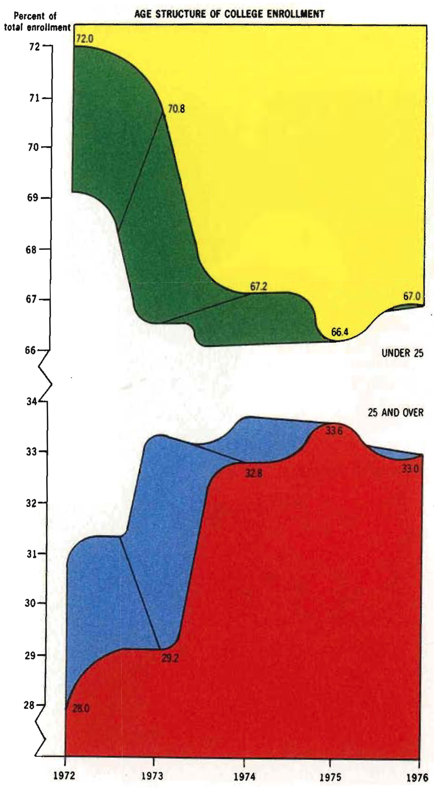

```{python}
#| include: false
# The slides read the repository copy of the data; students read the file they
# uploaded to Colab, which is the code shown on the slides. The figure size only
# makes the figures fit a slide: Colab's default is a little taller.
import pandas as pd
import matplotlib.pyplot as plt
pd.set_option("display.max_columns", 7)
pd.set_option("display.max_rows", 12)
plt.rcParams["figure.figsize"] = (8, 2.9)
plt.rcParams["figure.dpi"] = 110
insta = pd.read_csv("../data/insta-data.csv")
insta["posted_at"] = pd.to_datetime(insta["posted_at"])
insta["month"] = insta["posted_at"].dt.to_period("M")
insta["engagements"] = insta["likes"] + insta["comments"] + insta["saves"] + insta["shares"]
```

## Previously ...

- In Lecture 7 you calculated new columns, grouped the posts by format, month and campaign, and merged two files without multiplying the rows.

**Today, three questions:**

1. Which **figure** answers which question, in one line of pandas?
2. How do you make a figure **say something**?
3. How do you **save** a figure, and get a second opinion on it?

## Today's Notebook

A new notebook, `STA1000 Lecture 8`, and `insta-data.csv` uploaded. The first cell reuses Lecture 7:

```{.python}
import pandas as pd
import matplotlib.pyplot as plt
insta = pd.read_csv("insta-data.csv")
insta["posted_at"] = pd.to_datetime(insta["posted_at"])
insta["month"] = insta["posted_at"].dt.to_period("M")
insta["engagements"] = insta["likes"] + insta["comments"] + insta["saves"] + insta["shares"]
```

. . .

No new library to install: pandas draws its figures with **matplotlib**, which Colab already has. `plt` is its short name, as `pd` is pandas'.

# 1. One Line per Figure

## Tables In, Figures Out

```{python}
insta["format"].value_counts().plot(kind="barh")
```

`.plot()` draws the Series or the table in front of it: whatever you computed in Lecture 7 is one `.plot()` away from a figure.

Colab also prints a line such as `<Axes: ylabel='format'>`: the name of what was drawn. Ignore it, or end the line with `;` to hide it.

## The Question Picks the Figure

Lecture 3's four families of figure, plus time from Lecture 5:

::: {style="font-size:0.8em; line-height:1.3;"}

| The question | The family | In pandas |
|---|---|---|
| How do the posts split? | Composition | `.value_counts().plot(kind="barh")` |
| How does reach spread? | Distribution | `.plot(kind="hist")` |
| Does reach differ by format? | Comparison | `.plot(kind="box", by="format")` |
| Does revenue follow spend? | Relationship | `.plot(kind="scatter", x=..., y=...)` |
| How does reach change? | Evolution | a table by month, then `.plot()` |

:::

Start from the question, never from the list of `kind=`.

## Distribution: a Histogram

```{python}
insta[insta["reach"] < 50000]["reach"].plot(kind="hist", bins=40)
```

`bins=40` cuts the range into 40 bars. The 6 posts above 50,000 are left out, or the other 425 would squeeze into the first bar. **Leaving data out is a choice: say it on the figure.**

## Comparison: Box Plots

```{python}
insta.plot(kind="box", column="reach", by="format", logy=True);
```

Lecture 3's box plots. `logy=True`: a **log scale**, each gridline ten times the one below, so LR0184's 535,086 and LR0015's 361 fit on one figure.

## Comparison: a Grouped Table, as Bars

```{python}
by_format = insta.groupby("format")[["engagements", "reach"]].sum()
by_format["engagement_rate"] = by_format["engagements"] / by_format["reach"] * 100
by_format["engagement_rate"].sort_values().plot(kind="barh")
```

Compute with Lecture 7, then draw: the rate of the totals per format, in percent. `.sort_values()` first, so the longest bar is on top.

## Relationship: a Scatter Plot

```{python}
paid = insta[insta["is_paid"] == True]
paid.plot(kind="scatter", x="spend_eur", y="attributed_revenue_eur")
```

One point per paid post. Revenue rises with spend, but loosely: at about €200 of spend, from €200 to €2,200 of revenue.

## Evolution: a Line

```{python}
monthly = insta.groupby("month")["reach"].sum()
monthly.plot()
```

A line is the default `kind`. The table by month from Lecture 7, drawn: the August 2025 reel, and a second year that sits higher than the first.

## Several Lines: One Column per Line

```{python}
by_month = insta.pivot_table(index="month", columns="format", values="reach", aggfunc="sum")
by_month.plot()
```

A table with several columns draws one line per column, and a legend: the pivot table of Lecture 7 is ready to draw.

##  Your Turn! {background="#43464B"}

### Four families, on Loomrow

1. **Composition**: the number of posts by `product_line`, as horizontal bars, the largest on top
2. **Distribution**: a histogram of `likes`
3. **Comparison**: box plots of `likes` by `theme`, on a log scale
4. **Evolution**: the total `spend_eur` by month, as a line. When did Loomrow advertise?

::: {#timer8_1 .timer seconds="420" starton="interaction"}
:::

## Solution

```{python}
#| layout-ncol: 2
insta["product_line"].value_counts().sort_values().plot(kind="barh")
plt.show()
insta["likes"].plot(kind="hist", bins=40)
plt.show()
```

`plt.show()` closes a figure before the next one starts: without it, both would land on the same axes. That is what the `plt` of the first cell is for.

## Solution (continued)

```{python}
#| layout-ncol: 2
insta.plot(kind="box", column="likes", by="theme", logy=True, rot=45)
plt.show()
insta.groupby("month")["spend_eur"].sum().plot()
plt.show()
```

`rot=45` turns the labels. Loomrow advertises in bursts, around its campaigns: nothing in August 2025, its best month for reach.

# 2. Make It Say Something

## The Default Is a Draft

:::: {layout="[1,1]"}
::: {#first-column}

**What pandas gives you**

- A title? None
- The y axis? No name, no unit, numbers in hundreds of thousands
- The x axis? The name of a column
- The frame? On four sides

:::

::: {#second-column}

**What a reader needs**

- The **finding**, as the title
- What is measured, and in which **unit**
- Categories in a **meaningful order**
- Only the ink that carries data

:::
::::

. . .

pandas draws the data. **The finding is your job.**

## The Title Does the Work {.smaller}

:::: {layout="[1,1.2]"}
::: {#first-column}

 (CC BY 4.0)](./figures/external/mgt100_title_does_the_work.png){fig-align="center" style="max-height:400px;"}

:::

::: {#second-column}

**A title that names the fields**

"Reach by month, January 2025 to June 2026"

**A title that states the finding**

"One reel made August 2025 Loomrow's best month"

You know the finding before you read a single axis. If you cannot write the second title, the analysis is not finished.

:::
::::

## Title, Labels, Units

```{python}
ax = monthly.plot(title="One reel made August 2025 Loomrow's best month",
                  xlabel="", ylabel="Accounts reached")
ax.spines[["top", "right"]].set_visible(False)
```

`title=`, `xlabel=`, `ylabel=` go in the same `.plot()`. `ax =` keeps the figure's **axes** to change them after: here, the frame on the top and right goes.

## Order, Colour, Labels

```{python}
ax = by_format["engagement_rate"].sort_values().plot(
    kind="barh", color="#2a78d6", xlabel="", ylabel="",
    title="Carousels engage twice as well as reels (% of accounts reached)")
ax.spines[["top", "right"]].set_visible(False)
ax.bar_label(ax.containers[0], fmt="%.1f%%");
```

**One colour**: colour would encode nothing here. `ax.bar_label()` writes each value at the end of its bar, Lecture 4's direct labels.

## The Duck {.smaller}

:::: {layout="[1,1]"}
::: {#first-column}

**A building shaped like a duck**

{fig-align="center" style="max-height:300px;"}

:::

::: {#second-column}

**A chart shaped like a duck**

{fig-align="center" style="max-height:300px;"}

:::
::::

::: {style="font-size:0.55em;text-align:center;"}
Source: [SMM635 Data Visualisation, Bayes Business School](https://github.com/simoneSantoni/data-viz-smm635)
:::

Tufte's term: when the decoration becomes the structure, the chart is a duck. **Maximise the share of ink that shows data**: delete an element, and keep it deleted if the figure still works.

## Before You Show Anyone

1. The **title states the finding**, not the fields
2. Every axis says **what** is measured, and in which **unit**
3. Categories are **ordered** by value, not alphabetically
4. **Bars start at zero**: pandas does it, unless you change it
5. **Colour** only when it encodes something
6. What you **left out**, or put on a log scale, is **said** on the figure

##  Your Turn! {background="#43464B"}

### Fix this figure

This runs, and it says nothing. Make it say something:

```{.python}
insta.groupby("product_line")["reach"].median().plot(kind="bar")
```

1. Horizontal bars, sorted, the largest on top
2. A title that states the finding, and the unit
3. No axis label that repeats the title; no frame on the top and right
4. The value written at the end of each bar

::: {#timer8_2 .timer seconds="420" starton="interaction"}
:::

## Solution

```{python}
median_reach = insta.groupby("product_line")["reach"].median().sort_values()
ax = median_reach.plot(kind="barh", color="#2a78d6", xlabel="", ylabel="",
    title="Outerwear posts reach a fifth more accounts (median reach per post)")
ax.spines[["top", "right"]].set_visible(False)
ax.bar_label(ax.containers[0], fmt="%.0f");
```

Four lines instead of one, and a figure a founder reads in three seconds. The gap is real but small: medians of about 4,900 to 6,200.

# 3. Save It, Then Ask for a Second Opinion

## Save a Figure

```{.python}
ax.figure.savefig("median-reach.png", dpi=200, bbox_inches="tight")
```

- `ax.figure` is the whole figure around the axes; `.savefig()` writes it as a file in the Files panel
- `dpi=200`: sharp in a report or on a slide; `bbox_inches="tight"`: nothing cut off at the edges
- Then download it from the Files panel

. . .

**Save with code, not with a screenshot**: next month, the same cell redraws the figure on the new data.

##  Your Turn! {background="#43464B"}

### One figure for the founders

Loomrow's founders ask: **"Which format should we pay to boost?"**

1. Paid posts only: total `spend_eur` and `attributed_revenue_eur` by `format`
2. The return on ad spend, `roas`, of each format
3. One figure that answers the question, with a title that states the finding
4. Save it as `roas-by-format.png`, and download it

::: {#timer8_3 .timer seconds="480" starton="interaction"}
:::

## Solution {.smaller}

```{python}
paid = insta[insta["is_paid"] == True]
by_format = paid.groupby("format")[["spend_eur", "attributed_revenue_eur"]].sum()
by_format["roas"] = by_format["attributed_revenue_eur"] / by_format["spend_eur"]
ax = by_format["roas"].sort_values().plot(kind="barh", color="#2a78d6", xlabel="", ylabel="",
    title="Boosted reels return €3.58 a euro, images €2.57 (revenue per euro spent)")
ax.spines[["top", "right"]].set_visible(False)
ax.bar_label(ax.containers[0], fmt="€%.2f");
```

Reels **sell** most per euro; carousels engage most. **The question picks the figure.**

## Ask an AI to Critique It

In Lecture 4 you asked an AI what was wrong with the White House chart. Now ask about **your own** figure: attach the PNG you saved, not a description of it.

> "Here is a figure for the founders of a fashion label. Critique it as a non-technical reader would see it: what would they misread, and what would they conclude that the data does not support?"

. . .

> "Rewrite this title as a finding, at three levels of confidence."

The last clause of the first prompt matters: "critique this" gets you tidying; "what would they conclude that the data does not support?" gets you the failure.

## What It Cannot See

- Whether the finding is **true**: it critiques an image, not your data
- Whether the comparison is the one your founders care about
- Whether a rate has its **denominator**, unless the denominator is on the figure
- Your audience, unless you describe it

. . .

It will make your figure more conventional. Keep what you can defend, and say what you changed: Lecture 1's policy.

##  Your Turn! {background="#43464B"}

### A second opinion

1. Attach `roas-by-format.png` to an AI assistant, or copy the figure:  <kbd>⊞ Win</kbd> + <kbd>⇧ Shift</kbd> + <kbd>S</kbd> or  <kbd>⌘ Cmd</kbd> + <kbd>⌃ Control</kbd> + <kbd>⇧ Shift</kbd> + <kbd>4</kbd>. Ask the first prompt
2. Apply the two changes you agree with
3. Write down one piece of advice you rejected, and why
4. Ask for the title at three levels of confidence, and keep the one your data supports

::: {#timer8_4 .timer seconds="420" starton="interaction"}
:::

## {background="#43464B"}

```{=html}
<style>img.circle {border-radius:50%;}</style>
```

:::: {layout="[1,1]"}
::: {#first-column}


:::
::: {#second-column}
**Thanks for your attention and don't hesitate to ask if you have any questions!**

[ @damien_dupre](https://datasci.social/@damien_dupre)

[ @damien-dupre](https://github.com/damien-dupre)

[ https://damien-dupre.github.io](https://damien-dupre.github.io)

[ damien.dupre@dcu.ie](mailto:damien.dupre@dcu.ie)
:::
::::
