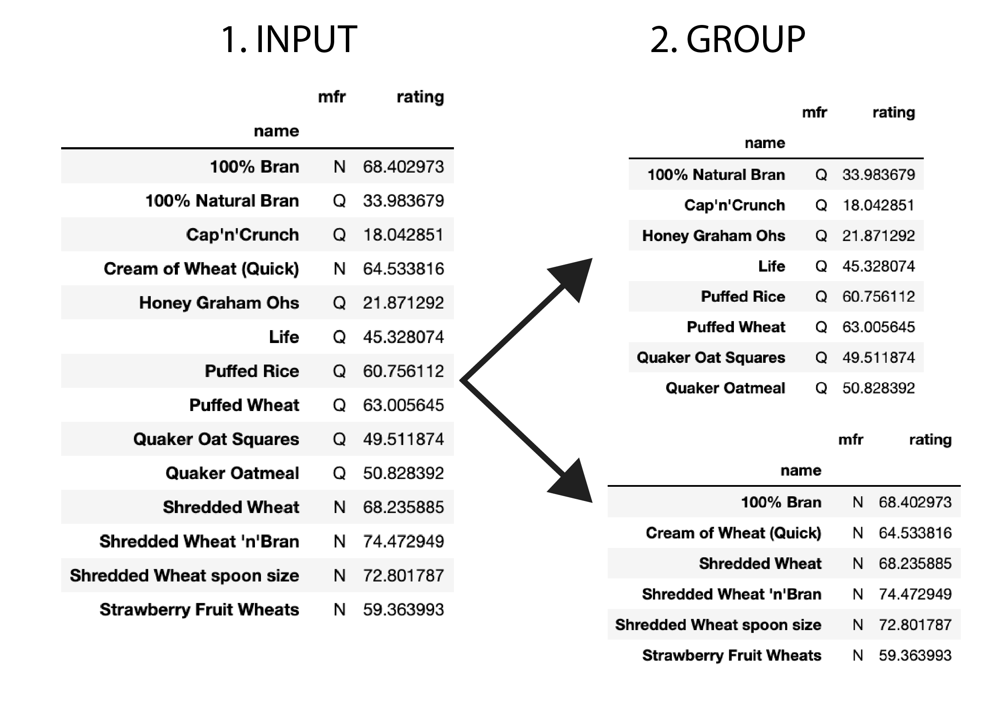
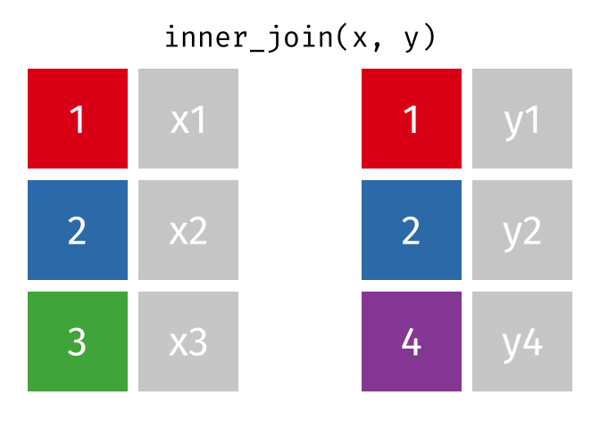

```{python}
#| include: false
# The slides read the repository copies of the data; students read the files they
# uploaded to Colab, which is the code shown on the slides.
import pandas as pd
pd.set_option("display.max_columns", 7)
pd.set_option("display.max_rows", 12)
pd.set_option("display.width", 80)
insta = pd.read_csv("../data/insta-data.csv")
insta["posted_at"] = pd.to_datetime(insta["posted_at"])
insta["engagements"] = insta["likes"] + insta["comments"] + insta["saves"] + insta["shares"]
posts = pd.read_csv("../data/merge/insta-posts.csv")
ads = pd.read_csv("../data/merge/meta-ads.csv")
countries = pd.read_csv("../data/maps/ads-by-country.csv")
```

## Previously ...

- In Lecture 7 you opened `insta-data.csv` with pandas, looked at it, selected, filtered and sorted its rows, and added calculated columns.

**Today, three questions:**

1. How do you **group** the rows, to compare formats, themes or campaigns?
2. How do you compute a **rate per group**, and group **by month**?
3. How do you **merge** two files, and check that nothing went wrong?

## Today's Notebook

A new notebook, `STA1000 Lecture 8`. From Loop, upload four files: `insta-data.csv`, `insta-posts.csv`, `meta-ads.csv` and `ads-by-country.csv`. Then, in the first cell:

```{.python}
import pandas as pd
insta = pd.read_csv("insta-data.csv")
insta["engagements"] = insta["likes"] + insta["comments"] + insta["saves"] + insta["shares"]
```

Lecture 7's first cell, plus the column today needs. The first cell of a notebook always does the same: load pandas, read the file, fix the types, add the columns.

# 1. Group the Rows

## The Question Behind Everything Today

- Lecture 7 answered: **what is in this table?**
- Today answers: **what is the answer per group?**

Almost every marketing question is a grouped one:

> Reach **per format**. Revenue **per campaign**. Sessions **per channel**, **per week**.

In Tableau, a dimension on Rows did it. In pandas, `.groupby()`.

## Split, Apply, Combine

:::: {layout="[1,1.4]"}
::: {#first-column}

1. **Split** the rows into groups, by the values of a column
2. **Apply** a calculation to each group
3. **Combine** the results into a new table

`.groupby()` does the splitting. On its own, it computes nothing.

:::

::: {#second-column}

{fig-align="center" style="max-height:380px;"}

::: {style="font-size:0.5em;text-align:center;"}
Source: UBC Master of Data Science, Programming in Python for Data Science [](https://prog-learn.mds.ubc.ca/)
:::

:::
::::

## Your First groupby

```{python}
insta.groupby("format")["reach"].median()
```

Read it left to right:

1. `.groupby("format")`: **split** the rows by format, as when `format` goes on Rows in Tableau
2. `["reach"]`: the column to calculate on
3. `.median()`: the calculation, applied to each group, and **combined** into one result. Or `.sum()`, `.mean()`, `.count()`

## Sort the Result

```{python}
insta.groupby("product_line")["reach"].median().sort_values(ascending=False)
```

The result of a `groupby` is an ordinary Series: everything from Lecture 7 still applies to it, `.sort_values()`, `.round()`, `.head()`. Outerwear reaches furthest.

## Several Columns at Once

```{python}
insta.groupby("format")[["reach", "engagements", "spend_eur"]].sum()
```

Two pairs of brackets again, a list of columns, as in Lecture 7. The result is a table with one row per format, and the formats as row names.

## Several Figures per Group

```{python}
insta.groupby("format")["reach"].agg(["count", "mean", "median"])
```

`.agg()` takes a list of calculations. `count` is the number of posts behind each figure: always show it next to a mean, and the mean next to the median.

## Round for the Reader

```{python}
insta.groupby("format")["reach"].agg(["count", "mean", "median"]).round(1)
```

`.round(1)` rounds what you show, to one decimal; `insta` keeps every digit for later calculations. Lecture 6's `round(value, 1)` works on one number, `.round(1)` on a whole column or table.

##  Your Turn! {background="#43464B"}

### Group the posts

Type each block in its own code cell, and run it:

```{.python}
# 1. the total likes of each theme, the largest first
insta.groupby("theme")["likes"].sum().sort_values(ascending=False)

# 2. the number of posts, and the mean and median saves, of each format
insta.groupby("format")["saves"].agg(["count", "mean", "median"]).round(1)

# 3. the total ad spend of each format
insta.groupby("format")["spend_eur"].sum()
```

::: {#timer8_1 .timer seconds="300" starton="interaction"}
:::

## Solution

```{python}
insta.groupby("theme")["likes"].sum().sort_values(ascending=False)
```

```{python}
insta.groupby("format")["saves"].agg(["count", "mean", "median"]).round(1)
```

Founder posts collect the most likes, sustainability posts the fewest. Carousels are saved most: a median of 49 saves, twice the reels'.

## Solution (continued)

```{python}
insta.groupby("format")["spend_eur"].sum()
```

The ad money splits almost evenly between carousels and reels, about €9,100 each, and €6,149 went on images.

# 2. A Rate per Group

## Average of the Rates, or Rate of the Totals?

```{python}
insta["engagement_rate"] = insta["engagements"] / insta["reach"] * 100
print(insta["engagement_rate"].mean())
print(insta["engagements"].sum() / insta["reach"].sum() * 100)
```

Lecture 4's row level against aggregate, in two lines:

- The **average of the rates**, 6.4%, gives each of the 431 posts the same weight
- The **rate of the totals**, 5.7%, gives each account reached the same weight

"Loomrow's engagement rate" is the second: **divide the totals**, never average the rates.

## Divide the Totals, per Group

```{python}
by_format = insta.groupby("format")[["engagements", "reach"]].sum()
by_format["engagement_rate"] = by_format["engagements"] / by_format["reach"] * 100
by_format
```

Group the counts first, then divide: the rate of the totals, per format. Reels reach the most accounts but have the lowest rate: 4.0%, against 8.4% for carousels.

##  Your Turn! {background="#43464B"}

### Which theme engages, which campaign pays?

Type each block in its own code cell, and run it:

```{.python}
# 1. the engagement rate of each theme: total engagements / total reach
by_theme = insta.groupby("theme")[["reach", "engagements"]].sum()
by_theme["engagement_rate"] = by_theme["engagements"] / by_theme["reach"] * 100
by_theme.sort_values("engagement_rate", ascending=False).round(1)

# 2. the revenue for each euro spent, roas, of each campaign
paid = insta[insta["is_paid"] == True]
by_campaign = paid.groupby("campaign")[["spend_eur", "attributed_revenue_eur"]].sum()
by_campaign["roas"] = by_campaign["attributed_revenue_eur"] / by_campaign["spend_eur"]
by_campaign.sort_values("roas", ascending=False).round(2)
```

::: {#timer8_2 .timer seconds="420" starton="interaction"}
:::

## Solution

```{python}
by_theme = insta.groupby("theme")[["reach", "engagements"]].sum()
by_theme["engagement_rate"] = by_theme["engagements"] / by_theme["reach"] * 100
by_theme.sort_values("engagement_rate", ascending=False).round(1)
```

**Customer** posts engage most; **behind the scenes** least, dragged down by LR0184 and its 535,086 accounts.

## Solution (continued)

```{python}
paid = insta[insta["is_paid"] == True]
by_campaign = paid.groupby("campaign")[["spend_eur", "attributed_revenue_eur"]].sum()
by_campaign["roas"] = by_campaign["attributed_revenue_eur"] / by_campaign["spend_eur"]
by_campaign.sort_values("roas", ascending=False).round(2)
```

**ROAS**, the return on ad spend: €6.97 a euro at Black Friday, €2.46 for the AW25 preorders.

# 3. Over Time, and in Two Dimensions

## Fix the Dates

In Lecture 5, Tableau recognised `posted_at` as a date. pandas reads it as text, and one line converts it:

```{python}
insta["posted_at"] = pd.to_datetime(insta["posted_at"])
insta["posted_at"].head(3)
```

- `insta["posted_at"] =` on the left **replaces** the column with what is on the right
- Add the first line to your **first cell**, which fixes the types, and run that cell again

## Date Parts and Date Values

```{python}
insta["year"] = insta["posted_at"].dt.year
insta["month"] = insta["posted_at"].dt.to_period("M")
insta["weekday"] = insta["posted_at"].dt.day_name()
insta[["posted_at", "year", "month", "weekday"]].head(2)
```

`.dt` opens the date toolbox of a date column. As with Tableau's two **Month** options in Lecture 5:

- **Date parts**: `.dt.year`, `.dt.month`, `.dt.day_name()`: "Monday" means every Monday
- **Date values**: `.dt.to_period("M")`: that month only, 2025-01, as the **Month** with a year

## Over Time

```{python}
monthly = insta.groupby("month")["reach"].sum()
monthly.sort_values(ascending=False).head(3)
```

Group by a date value, and each month becomes a row: Lecture 5's line chart, as a table. August 2025 is the month of the viral reel. Lecture 9 draws the line.

## Two Dimensions: a Pivot Table

```{python}
insta.pivot_table(index="format", columns="is_paid", values="reach", aggfunc="sum")
```

- `index`: the rows; `columns`: the columns; `values`: the column to calculate on; `aggfunc`: the calculation
- Tableau's crosstab, with `format` on Rows and `is_paid` on Columns. An Excel pivot table, written down

##  Your Turn! {background="#43464B"}

### Loomrow over time

Type each block in its own code cell, and run it:

```{.python}
# 1. the year of each post
insta["year"] = insta["posted_at"].dt.year

# 2. the reach of each year, then of January to June only
print(insta.groupby("year")["reach"].sum())
first_half = insta[insta["posted_at"].dt.month <= 6]
print(first_half.groupby("year")["reach"].sum())

# 3. the number of posts of each format, organic (False) or paid (True)
insta.pivot_table(index="format", columns="is_paid", values="post_id", aggfunc="count")
```

::: {#timer8_3 .timer seconds="420" starton="interaction"}
:::

## Solution

```{python}
print(insta.groupby("year")["reach"].sum())
first_half = insta[insta["posted_at"].dt.month <= 6]
print(first_half.groupby("year")["reach"].sum())
```

Fewer in total, because 2026 stops on 24 June: compare the same months, as in Lecture 5. From January to June, 2026 reached **4.6 times** as many accounts as 2025.

## Solution (continued)

```{python}
insta.pivot_table(index="format", columns="is_paid", values="post_id", aggfunc="count")
```

45 of the 144 carousels were boosted, 50 of the 203 reels, and 32 of the 84 images.

# 4. Merge Two Files

## Two Files, One Key

Lecture 4 split the Loomrow data in two, as it arrives from two platforms:

```{.python}
posts = pd.read_csv("insta-posts.csv")
ads = pd.read_csv("meta-ads.csv")
```

```{python}
print(posts.shape, ads.shape)
ads.head(3)
```

`insta-posts.csv` has the 431 posts, from Instagram; `meta-ads.csv` the 127 boosted posts, from Meta Ads Manager. **The key** they share: `post_id`.

## Joins, Animated

:::: {layout="[1,1]"}
::: {#first-column}



**Inner**: only the keys found in both tables

:::

::: {#second-column}


**Left**: every row of the left table, matched or not

:::
::::

::: {style="font-size:0.7em;text-align:center;"}
Lecture 4's animations: `x` is the left table and `y` the right one. Source: Garrick Aden-Buie, tidyexplain [](https://www.garrickadenbuie.com/project/tidyexplain/)
:::

## pd.merge()

```{python}
both = pd.merge(posts, ads, on="post_id", how="left")
both.shape
```

- `pd.merge(left, right, ...)`: the two tables, in that order
- `on="post_id"`: the key, a column present in both
- `how="left"`: keep every row of the left table, matched or not

The ad columns are added at the end: 23 + 3 = 26 columns, `insta-data.csv` again.

## Which Rows Survive?

:::: {layout="[1,1]"}
::: {#first-column}

| `how=` | Keeps | Rows |
|---|---|---|
| `"inner"` | the keys in **both** | 127 |
| `"left"` | every row on the **left** | 431 |
| `"right"` | every row on the **right** | 127 |
| `"outer"` | every key, from **either** | 431 |

:::

::: {#second-column}

Lecture 4's join types, with the same counts.

`"left"` is almost always the one: keep all your observations, and add information where it exists.

`"inner"`, the default when `how` is left out, drops the 304 organic posts **without a word**.

:::
::::

## Missing Values

```{python}
insta["campaign"].value_counts(dropna=False)
```

- `NaN` marks a missing value: 225 posts went out outside any campaign
- `insta["campaign"].isna().sum()` counts them: `.isna()` is True where a value is missing, and `.sum()` counts the True
- **Missing does not mean wrong.** Here it means "no campaign". Find out what it means before you drop or fill it

## Missing Values After a Merge

A post with no ad has nothing to match in `meta-ads.csv`: its ad columns are **missing**, `NaN`, like the `campaign` of the 225 posts outside any campaign.

```{python}
print(both["spend_eur"].isna().sum())
both["spend_eur"] = both["spend_eur"].fillna(0)
print(round(both["spend_eur"].sum(), 2))
```

- `.isna().sum()` counts the missing values: 304, the organic posts
- `.fillna(0)` replaces them with 0. Right here, because no ad means €0 spent. Wrong for a missing price or a missing age: decide, and say so

## Check Every Merge: Rows and a Total

Before and after each merge, two checks:

1. **The number of rows**: did it change, and should it have?
2. **A total you know**: €24,345.78 of spend, as in Meta Ads Manager

`ads-by-country.csv`, Lecture 5's file, has **one row per post and country**:

```{.python}
countries = pd.read_csv("ads-by-country.csv")
```

```{python}
wrong = pd.merge(insta, countries, on="post_id")
print(countries.shape, wrong.shape)
print(round(wrong["spend_eur"].sum(), 2))
```

Each paid post is repeated once per country, and so is its `spend_eur`: Lecture 5's €106,899.36. The code ran without an error. Only the checks catch it.

##  Your Turn! {background="#43464B"}

### Rebuild the Loomrow file

With `posts` and `ads` read as on the slides, type each block in its own code cell, and run it:

```{.python}
# 1. keep only the posts found in both files: how many rows?
pd.merge(posts, ads, on="post_id", how="inner").shape

# 2. keep every post, and count the posts with no ad
both = pd.merge(posts, ads, on="post_id", how="left")
print(both.shape)
print(both["spend_eur"].isna().sum())

# 3. put 0 in the empty ad columns: €24,345.78 spent, €76,928.88 of revenue?
ad_columns = ["spend_eur", "attributed_purchases", "attributed_revenue_eur"]
both[ad_columns] = both[ad_columns].fillna(0)
both[ad_columns].sum()

# 4. save the table, then download it from the Files panel
both.to_csv("insta-rebuilt.csv", index=False)
```

::: {#timer8_4 .timer seconds="420" starton="interaction"}
:::

## Solution

```{python}
print(pd.merge(posts, ads, on="post_id", how="inner").shape)
both = pd.merge(posts, ads, on="post_id", how="left")
print(both.shape, both["spend_eur"].isna().sum())
ad_columns = ["spend_eur", "attributed_purchases", "attributed_revenue_eur"]
both[ad_columns] = both[ad_columns].fillna(0)
print(both[ad_columns].sum())
```

```{.python}
both.to_csv("insta-rebuilt.csv", index=False)
```

The inner merge keeps only the 127 boosted posts: the 304 organic ones are gone.

## {background="#43464B"}

```{=html}
<style>img.circle {border-radius:50%;}</style>
```

:::: {layout="[1,1]"}
::: {#first-column}


:::
::: {#second-column}
**Thanks for your attention and don't hesitate to ask if you have any questions!**

[ @damien_dupre](https://datasci.social/@damien_dupre)

[ @damien-dupre](https://github.com/damien-dupre)

[ https://damien-dupre.github.io](https://damien-dupre.github.io)

[ damien.dupre@dcu.ie](mailto:damien.dupre@dcu.ie)
:::
::::
