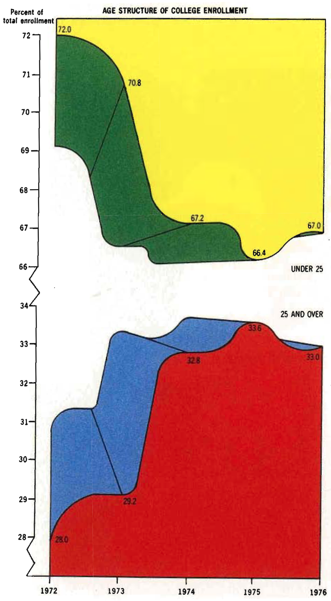

```{python}
#| include: false
# The slides read the repository copy of the data; students read the file they
# uploaded to Colab, which is the code shown on the slides. The figure size only
# makes the figures fit a slide: Colab's default is a little taller.
import pandas as pd
import matplotlib.pyplot as plt
pd.set_option("display.max_columns", 7)
pd.set_option("display.max_rows", 12)
plt.rcParams["figure.figsize"] = (8, 2.5)
plt.rcParams["figure.dpi"] = 110
insta = pd.read_csv("../data/insta-data.csv")
insta["posted_at"] = pd.to_datetime(insta["posted_at"])
insta["month"] = insta["posted_at"].dt.to_period("M")
insta["engagements"] = insta["likes"] + insta["comments"] + insta["saves"] + insta["shares"]
insta["engagement_rate"] = insta["engagements"] / insta["reach"] * 100
```

## Previously ...

- In Lecture 7 you grouped the posts by format and theme, in a `groupby` or a pivot table. In Lecture 8 you divided totals to get a rate per group, grouped by month, and merged two files without multiplying the rows.

**Today, three questions:**

1. Which **figure** answers which **question**?
2. How do you draw it in **one line** of pandas?
3. How do you make it **say something**, save it, and use an **AI assistant** well?

## Today's Notebook

A new notebook, `STA1000 Lecture 9`, and `insta-data.csv` uploaded. The first cell reuses Lectures 7 and 8:

```{.python}
import pandas as pd
import matplotlib.pyplot as plt
insta = pd.read_csv("insta-data.csv")
insta["posted_at"] = pd.to_datetime(insta["posted_at"])
insta["month"] = insta["posted_at"].dt.to_period("M")
insta["engagements"] = insta["likes"] + insta["comments"] + insta["saves"] + insta["shares"]
insta["engagement_rate"] = insta["engagements"] / insta["reach"] * 100
```

No new library to install: pandas draws its figures with **matplotlib**, which Colab already has. `plt` is its short name, as `pd` is pandas'.

# 1. The Question Picks the Figure

## Summary Statistics Lie

```{python}
#| echo: false
#| fig-align: center
anscombe = {
    "I": ([10, 8, 13, 9, 11, 14, 6, 4, 12, 7, 5],
          [8.04, 6.95, 7.58, 8.81, 8.33, 9.96, 7.24, 4.26, 10.84, 4.82, 5.68]),
    "II": ([10, 8, 13, 9, 11, 14, 6, 4, 12, 7, 5],
           [9.14, 8.14, 8.74, 8.77, 9.26, 8.10, 6.13, 3.10, 9.13, 7.26, 4.74]),
    "III": ([10, 8, 13, 9, 11, 14, 6, 4, 12, 7, 5],
            [7.46, 6.77, 12.74, 7.11, 7.81, 8.84, 6.08, 5.39, 8.15, 6.42, 5.73]),
    "IV": ([8, 8, 8, 8, 8, 8, 8, 19, 8, 8, 8],
           [6.58, 5.76, 7.71, 8.84, 8.47, 7.04, 5.25, 12.50, 5.56, 7.91, 6.89]),
}
fig, axes = plt.subplots(1, 4, figsize=(9, 2.4), sharex=True, sharey=True)
for ax, (name, (x, y)) in zip(axes, anscombe.items()):
    ax.scatter(x, y, s=18, color="#2a78d6")
    ax.plot([3, 20], [3 + 0.5 * 3, 3 + 0.5 * 20], color="#e34948", linewidth=1)
    ax.set_title(f"Dataset {name}", fontsize=10)
    ax.tick_params(labelsize=8)
plt.tight_layout()
plt.show()
```

Four datasets of eleven points. The **same** means, standard deviations, correlation and regression line, to two decimals: **Anscombe's quartet**, 1973.

A table of key figures cannot tell these four apart. **Always plot the data.**

## The Question Picks the Figure

Lecture 3's four families of figure, plus time from Lecture 5:

::: {style="font-size:0.8em; line-height:1.3;"}

| The question | The family | In pandas |
|---|---|---|
| How do the posts split? | Composition | `.value_counts().plot(kind="barh")` |
| How does reach spread? | Distribution | `.plot(kind="hist")` |
| Does the rate differ by format? | Comparison | `.plot(kind="box", by="format")` |
| Does revenue follow spend? | Relationship | `.plot(kind="scatter", x=..., y=...)` |
| How does reach change? | Evolution | a table by month, then `.plot()` |

:::

Start from the question, never from the list of `kind=`.

##  Your Turn! {background="#43464B"}

### Choose the figure

No code. For each question, write in a text cell the figure you would draw, **bars**, a **histogram**, **box plots**, a **scatter plot** or a **line**, and why:

1. Is the reach of the posts spread evenly, or clustered at the bottom?
2. Which product line has the most posts?
3. Has the monthly reach risen since January 2025?
4. Do the boosted posts that cost more bring more revenue?
5. Do reels engage differently from carousels?

::: {#timer9_1 .timer seconds="240" starton="interaction"}
:::

## One Answer

| Question | Figure | Why |
|:--|:--|:--|
| Reach spread | histogram | the shape of one number |
| Posts per product line | sorted bars | a count, a few categories |
| Monthly reach | line | one number over time |
| Spend and revenue | scatter plot | two numbers together |
| Reels against carousels | box plots | spreads, side by side |

**The question picks the figure.** Choosing the figure first, then hunting for something to put in it, is how bad dashboards are born.

# 2. One Line per Figure

## Tables In, Figures Out

```{python}
insta["format"].value_counts().plot(kind="barh")
```

`.plot()` draws the Series or the table in front of it: whatever you computed in Lectures 7 and 8 is one `.plot()` away from a figure.

Colab may also print a line such as `<Axes: ylabel='format'>`: end the line with `;` to hide it.

## Distribution: a Histogram

```{python}
insta[insta["reach"] < 50000]["reach"].plot(kind="hist", bins=40)
```

`bins=40` cuts the range into 40 bars. The 6 posts above 50,000 are left out, or most of the other 425 would squeeze into the first bar. **Leaving data out is a choice: say it on the figure.**

## Comparison: Box Plots

```{python}
insta.plot(kind="box", column="engagement_rate", by="format");
```

Lecture 3's box plots: the line is the median, the box holds the middle half of the posts. Every carousel engages more than every reel: a median of 8.4% against 5.1%.

## Comparison: a Grouped Table, as Bars

```{python}
by_format = insta.groupby("format")[["engagements", "reach"]].sum()
by_format["engagement_rate"] = by_format["engagements"] / by_format["reach"] * 100
by_format["engagement_rate"].sort_values().plot(kind="barh")
```

Compute with Lecture 8, then draw: the rate of the totals per format, as a percentage. `.sort_values()` first, so the longest bar is on top.

## Relationship: a Scatter Plot

```{python}
paid = insta[insta["is_paid"] == True]
paid.plot(kind="scatter", x="spend_eur", y="attributed_revenue_eur")
```

One point per paid post; posts boosted on the same day carry the same spend and revenue, so some points overlap. Revenue rises with spend, but loosely: at about €200 of spend, from €250 to €2,200 of revenue.

## Evolution: a Line

```{python}
monthly = insta.groupby("month")["reach"].sum()
monthly.plot()
```

A line is the default `kind`. Lecture 8's table by month, drawn: the August 2025 reel, and a second year that sits higher than the first.

## Several Lines: One Column per Line

```{python}
by_month = insta.pivot_table(index="month", columns="format", values="reach", aggfunc="sum")
by_month.plot()
```

A table with several columns draws one line per column, and a legend: Lecture 7's pivot table, by Lecture 8's month, is ready to draw.

## One Figure, or Several, per Cell

```{.python}
insta["product_line"].value_counts().plot(kind="barh")
plt.show()
insta["likes"].plot(kind="hist", bins=40)
plt.show()
```

- One figure per cell: nothing to add
- Several figures in one cell: end each one with `plt.show()`, which closes it before the next one starts. Without it, both land on the same axes

That is what the `plt` of the first cell is for.

##  Your Turn! {background="#43464B"}

### Four families, on Loomrow

Type each block in its own code cell, and run it:

```{.python}
# 1. composition: the number of posts of each product line
insta["product_line"].value_counts().sort_values().plot(kind="barh");

# 2. distribution: the likes of the posts
insta["likes"].plot(kind="hist", bins=40);

# 3. comparison: the engagement rate of each theme
insta.plot(kind="box", column="engagement_rate", by="theme", rot=45);

# 4. evolution: the ad spend of each month
insta.groupby("month")["spend_eur"].sum().plot();
```

::: {#timer9_2 .timer seconds="420" starton="interaction"}
:::

## Solution

```{python}
#| layout-ncol: 2
insta["product_line"].value_counts().sort_values().plot(kind="barh")
plt.show()
insta["likes"].plot(kind="hist", bins=40)
plt.show()
```

The product lines are almost even. Likes are skewed, as reach was: most posts get a few hundred, a few get thousands.

## Solution (continued)

```{python}
#| layout-ncol: 2
insta.plot(kind="box", column="engagement_rate", by="theme", rot=45)
plt.show()
insta.groupby("month")["spend_eur"].sum().plot()
plt.show()
```

`rot=45` turns the labels. The theme barely changes the rate; the format does. And Loomrow advertises in bursts, around its campaigns.

# 3. Make It Say Something

## The Default Is a Draft

:::: {layout="[1,1]"}
::: {#first-column}

**What pandas gives you**

- A title? None
- The y axis? No name, no unit, numbers in hundreds of thousands
- The x axis? The name of a column
- The categories? In alphabetical order

:::

::: {#second-column}

**What a reader needs**

- The **finding**, as the title
- What is measured, and in which **unit**
- Categories in a **meaningful order**
- Only the ink that carries data

:::
::::

pandas draws the data. **The finding is your job.**

## The Title Does the Work {.smaller}

:::: {layout="[1,1.2]"}
::: {#first-column}

 (CC BY 4.0)](./figures/external/mgt100_title_does_the_work.png){fig-align="center" style="max-height:400px;"}

:::

::: {#second-column}

**A title that names the fields**

"Reach by month, January 2025 to June 2026"

**A title that states the finding**

"One reel made August 2025 Loomrow's best month"

You know the finding before you read a single axis. If you cannot write the second title, the analysis is not finished.

:::
::::

## Title, Labels, Units

```{python}
monthly.plot(title="One reel made August 2025 Loomrow's best month",
             xlabel="", ylabel="Accounts reached");
```

`title=`, `xlabel=` and `ylabel=` go inside the same `.plot()`, separated by commas. `xlabel=""` removes a label that says nothing.

## Order and Colour

```{python}
by_format["engagement_rate"].sort_values().plot(
    kind="barh", color="#2a78d6", xlabel="", ylabel="",
    title="Carousels engage best, reels least (% of accounts reached)");
```

**Sorted**, so the order carries the finding; **one colour**, as colour would encode nothing here; the unit in the title. A line too long can continue inside its brackets.

## The Duck {.smaller}

:::: {layout="[1,1]"}
::: {#first-column}

**A building shaped like a duck**

{fig-align="center" style="max-height:300px;"}

:::

::: {#second-column}

**A chart shaped like a duck**

{fig-align="center" style="max-height:300px;"}

:::
::::

::: {style="font-size:0.55em;text-align:center;"}
Source: [SMM635 Data Visualisation, Bayes Business School](https://github.com/simoneSantoni/data-viz-smm635)
:::

Tufte's term: when the decoration becomes the structure, the chart is a duck. **Maximise the share of ink that shows data**: delete an element, and keep it deleted if the figure still works.

## Before You Show Anyone

1. The **title states the finding**, not the fields
2. Every axis says **what** is measured, and in which **unit**, or the title does
3. Categories are **ordered** by value, not alphabetically
4. **Bars start at zero**: pandas does it, unless you change it
5. **Colour** only when it encodes something
6. What you **left out**, or put on another scale, is **said** on the figure

##  Your Turn! {background="#43464B"}

### Fix this figure

`insta.groupby("product_line")["reach"].median().plot(kind="bar")` runs, and says nothing. Type each block in its own code cell, and run it:

```{.python}
# 1. sorted, as horizontal bars
median_reach = insta.groupby("product_line")["reach"].median().sort_values()
median_reach.plot(kind="barh");

# 2. one colour, and no axis labels
median_reach.plot(kind="barh", color="teal", xlabel="", ylabel="");

# 3. a title: replace ____ with what the figure shows
median_reach.plot(kind="barh", color="teal", xlabel="", ylabel="",
                  title="____ (median reach per post)");
```

::: {#timer9_3 .timer seconds="360" starton="interaction"}
:::

## Solution

```{python}
median_reach = insta.groupby("product_line")["reach"].median().sort_values()
median_reach.plot(kind="barh", color="#2a78d6", xlabel="", ylabel="",
                  title="Outerwear posts reach the most accounts, by a narrow margin (median reach per post)");
```

Two lines instead of one, and a figure a founder reads in three seconds. "By a narrow margin" is part of the finding: medians of about 4,900 to 6,200, on 78 to 92 posts each, a gap small enough to be chance.

# 4. Save It, Then Ask an AI Assistant

## Save a Figure

```{.python}
median_reach.plot(kind="barh", color="#2a78d6", xlabel="", ylabel="",
                  title="Outerwear posts reach the most accounts, by a narrow margin (median reach per post)")
plt.savefig("median-reach.png", dpi=200, bbox_inches="tight")
```

- `plt.savefig()`, **in the same cell** as the figure, writes it as a file in the Files panel
- `dpi=200`: sharp in a report or on a slide; `bbox_inches="tight"`: nothing cut off at the edges
- Then download it from the Files panel

**Save with code, not with a screenshot**: next month, the same cell redraws the figure on the new data.

## The Elephant in the Room

You all have access to ChatGPT, Claude, Copilot or Gemini, and Colab has Gemini built in if your account offers it.

Pretending otherwise would be silly. **Using them well is now part of the skill.**

Lecture 1's policy holds: use it, say so, and you are **responsible for every number** you submit.

## Good At, Bad At

:::: {layout="[1,1]"}
::: {#first-column}

**What AI is good at**

- Explaining an error message in plain English
- Explaining a line you do not understand
- Translating "the average reach per format" into pandas

:::

::: {#second-column}

**What AI is bad at**

- Knowing what your data looks like
- Knowing which question is worth asking
- Admitting it does not know: it invents functions that do not exist

:::
::::

**The assistant writes a plausible answer. Only you can check it is the right one.**

## Prompting That Works

Weak prompt:

> make a chart of my data

Strong prompt:

> I have a pandas table called `insta` with the columns `format` (text) and `reach` (whole numbers). Write the pandas code for a sorted bar chart of the median reach of each format, and explain each line.

The difference is **context, names, types, and the request to explain**.

## Ask an AI to Critique It

In Lecture 4 you asked an AI what was wrong with the White House chart. Now ask about **your own** figure: attach the PNG you saved, not a description of it.

> "Here is a figure for the founders of a fashion label. Critique it as a non-technical reader would see it: what would they misread, and what would they conclude that the data does not support?"

The last clause matters: "critique this" gets you tidying; "what would they conclude that the data does not support?" gets you the failure.

## What It Cannot See

- Whether the finding is **true**: it critiques an image, not your data
- Whether the comparison is the one your founders care about
- Whether a rate has its **denominator**, unless the denominator is on the figure
- Your audience, unless you describe it

It will make your figure more conventional. Keep what you can defend, and say what you changed: Lecture 1's policy.

## The Rule for Lectures 6 to 9

- **Type the code yourself.** Copy-paste teaches nothing; muscle memory is real
- Ask the assistant to **explain**, rather than to write: a line you cannot read is a line you cannot check
- If it gives you a function we have not seen, ask what it does before using it

You are not being trained to produce code. You are being trained to **judge** code. Lecture 10 hands the assistant the keyboard, once you can tell when it is wrong.

##  Your Turn! {background="#43464B"}

### "Which format should we pay to boost?"

The founders' question, in one figure. Type each block in its own code cell, and run it:

```{.python}
# 1. the revenue for each euro spent, roas, of each format, paid posts only
paid = insta[insta["is_paid"] == True]
by_format = paid.groupby("format")[["spend_eur", "attributed_revenue_eur"]].sum()
by_format["roas"] = by_format["attributed_revenue_eur"] / by_format["spend_eur"]

# 2. the figure, saved: replace ____ with a title that answers the founders
by_format["roas"].sort_values().plot(kind="barh", color="teal", xlabel="", ylabel="",
    title="____")
plt.savefig("roas-by-format.png", dpi=200, bbox_inches="tight")
```

3. Download `roas-by-format.png` from the **Files** panel
4. Ask an AI assistant to critique it, as on the slides

::: {#timer9_4 .timer seconds="720" starton="interaction"}
:::

## Solution

```{python}
paid = insta[insta["is_paid"] == True]
by_format = paid.groupby("format")[["spend_eur", "attributed_revenue_eur"]].sum()
by_format["roas"] = by_format["attributed_revenue_eur"] / by_format["spend_eur"]
by_format["roas"].sort_values().plot(kind="barh", color="#2a78d6", xlabel="", ylabel="",
    title="Boosted reels return €3.58 a euro, images €2.57 (revenue per euro spent)");
```

Reels **sell** most per euro; carousels engage most. **The question picks the figure.**

## {background="#43464B"}

```{=html}
<style>img.circle {border-radius:50%;}</style>
```

:::: {layout="[1,1]"}
::: {#first-column}


:::
::: {#second-column}
**Thanks for your attention and don't hesitate to ask if you have any questions!**

[ @damien_dupre](https://datasci.social/@damien_dupre)

[ @damien-dupre](https://github.com/damien-dupre)

[ https://damien-dupre.github.io](https://damien-dupre.github.io)

[ damien.dupre@dcu.ie](mailto:damien.dupre@dcu.ie)
:::
::::
